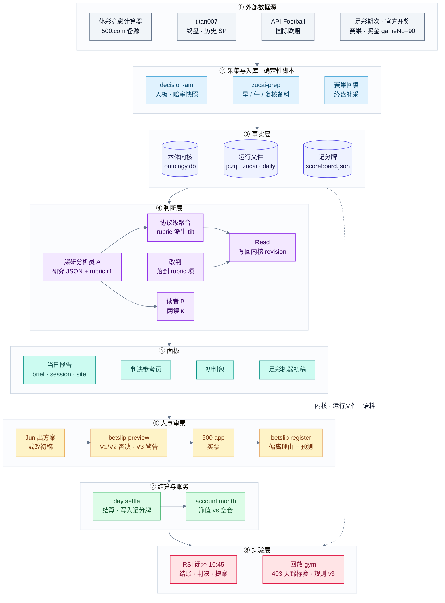
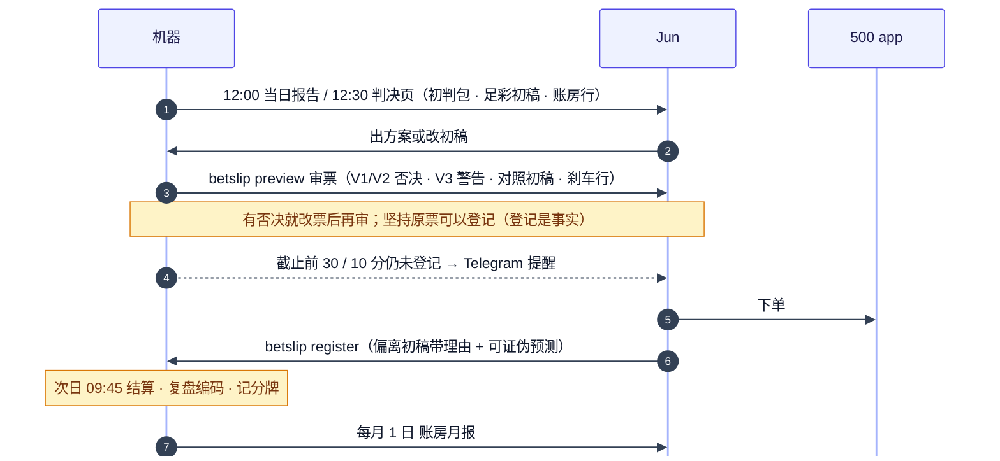
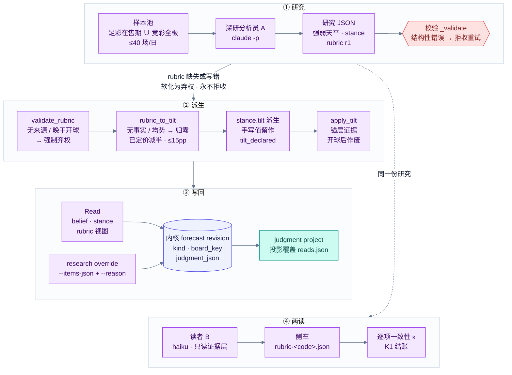
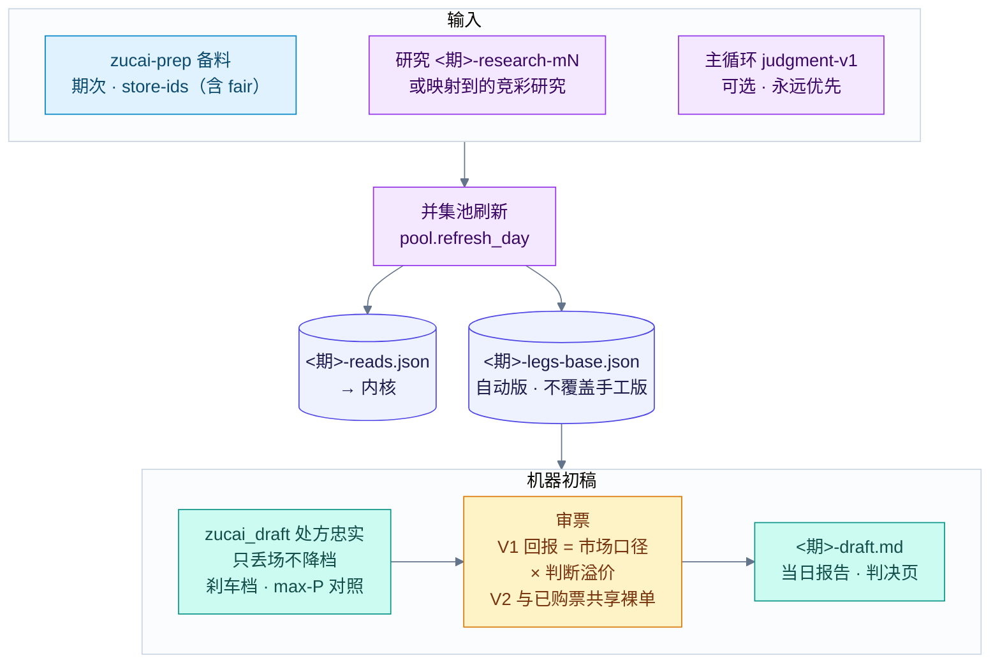
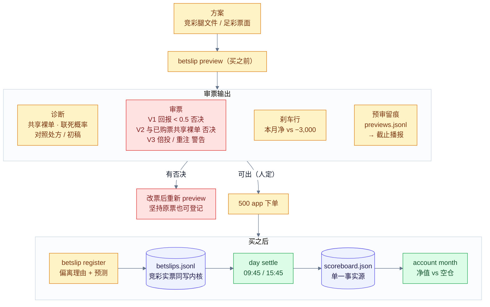
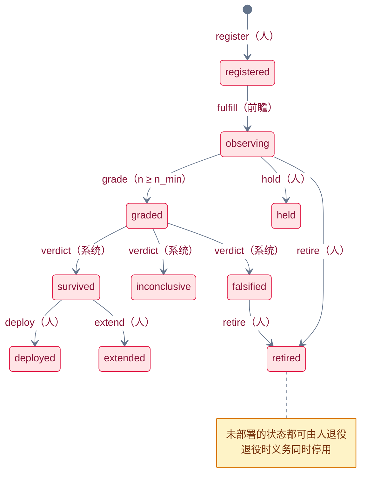
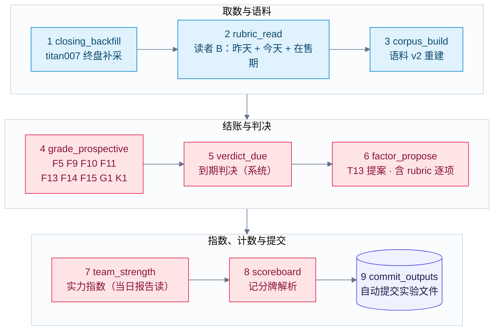
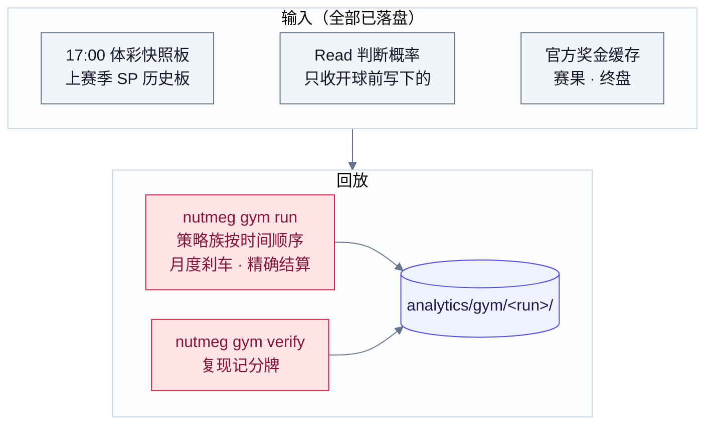
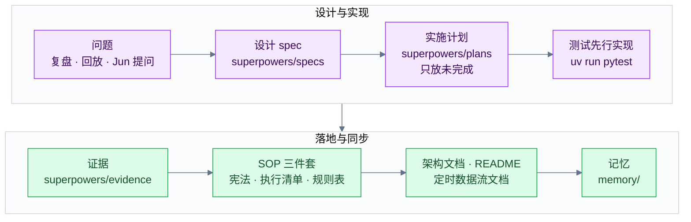

# Nutmeg 系统架构设计

| 项 | 内容 |
|---|---|
| 文档 | 现役系统结构总图（权威） |
| 版本 | v1.2 · 2026-10-05 |
| 范围 | 定位 · 系统总图 · 每日时序 · 判断层 · 出票审票与账务 · RSI 实验层 · 回放 gym · 数据对象 · 全量分析过程 · 工程流程 · 文档地图 · 术语表 |
| 读者 | Jun（下注者与决策人）· Claude 主循环 · Codex / OpenClaw 会话 |
| 权威关系 | 原则与规则以 SOP 三件套为准；数字以 `.nutmeg-data/scoreboard.json` 与内核为准；本文与它们冲突时以它们为准，并回来改本文 |

> [!IMPORTANT]
> **维护规则**：任何改变组件边界、定时任务、对象或流程的提交，同一提交更新本文对应小节与图。新增或退役定时器还要同步 `nutmeg/decision/day_runs.py:JOBS` 与 `docs/ops/2026-09-20-scheduled-dataflows.md`。

**图例**（全文统一配色）

| 颜色 | 层 | 典型对象 |
|---|---|---|
| ⬜ 灰 | 外部数据源 | 体彩计算器、titan007、API-Football、官方开奖 |
| 🟦 蓝 | 采集与入库（确定性脚本） | `decision-am`、`zucai-prep`、赛果回填 |
| 🟪 靛 | 事实层 | 本体内核、运行文件、记分牌 |
| 🟣 紫 | 判断层 | 深研分析员、rubric、Read、改判、读者 B |
| 🟩 青 | 面板 | 当日报告、判决页、初判包、足彩初稿 |
| 🟨 琥珀 | 人与审票 | Jun、`betslip preview` / `register` |
| 🟢 绿 | 结算与账务 | 结算、记分牌、账房 |
| 🟥 玫红 | 实验层 | RSI 闭环、回放 gym |

## 目录

- [0. 定位与原则](#0-定位与原则)
- [1. 系统总图](#1-系统总图)
- [2. 每日时序](#2-每日时序)
- [3. 判断层](#3-判断层)
- [4. 出票、审票、登记与账务](#4-出票审票登记与账务)
- [5. RSI 实验层](#5-rsi-实验层)
- [6. 回放 gym（Dream 已退役）](#6-回放-gymdream-已退役)
- [7. 数据对象](#7-数据对象)
- [8. 全量分析过程（证据链）](#8-全量分析过程证据链)
- [9. 工程流程](#9-工程流程)
- [10. 文档地图](#10-文档地图)
- [11. 术语表](#11-术语表)
- [12. 版本记录](#12-版本记录)

---

## 0. 定位与原则

Nutmeg 是中国体彩**竞彩足球（JCZQ）**与**传统足彩（胜负彩 / 任九）**的判断与账务系统。

> [!IMPORTANT]
> **2026-10-01 定位（Jun 同意）**：403 天回放证明机器的判断概率≈市场、帽内最大化全对概率的出票形状长期亏损、没有任何策略族在样本外 ROI 为正。**机器不再是最终决策者。** 目标函数从「赚钱」改为「少亏多少 + 证伪了几条」。

| 角色 | 由谁担任 | 做什么 |
|---|---|---|
| 风控官 | 机器 | 审票：只否决有实证的坏结构（V1 期望回报 < 0.5、V2 与已购票共享裸单），其余只警告与给数字 |
| 账房 | 机器 | 诚实账本：月净值 vs 空仓、止损线 −¥3,000、偏离初稿按理由结账、主指标「实际 vs 规则 v3 vs 空仓」（gym 回放本月竞彩）、判断力指标 |
| 实验员 | 机器 | 预登记实验、逐项结账、证伪；探索预算 ≤¥30/日只给预登记实验 |
| 研究员 | 机器 | 每天对样本池逐场深研，按固定问题表（rubric r1）作答，出初判包；足彩另出**机器初稿** |
| 下注者 | Jun | 出当日方案、改初稿、买票、登记 |

**两条元原则**（宪法 §3）

1. **判断永不入脚本**：脚本只做取数、采集、确定性算术三件事，判读由主循环实时推理。
2. **判据必须入代码**：散文规则挡不住「第五个更好的理由」；没被对象化的知识不参与执行。

---

## 1. 系统总图

*图 1　系统总图：八层流水线。实线为每日主流向，虚线为实验层对事实层的直接读取。*

| 层 | 主要代码 | 权威产物 |
|---|---|---|
| 采集 | `nutmeg/decision/fetch.py` `market_data.py` `zucai_prep.py`、`scripts/titan007_closing_backfill.py` `scripts/jczq_result_backfill.py` | `jczq/daily/<日>/sporttery_markets.json` `jczq/jc-results.json` `zucai/<期>-issue.json` `zucai/official-*.json` |
| 内核 | `nutmeg/ontology/`（repository / actions / migrations，schema 47） | `.nutmeg-data/ontology/ontology.db` |
| 判断 | `research_runner.py` `research_prompt.py` `rubric_items.py` `rubric.py` `stance.py` `jczq_reads.py` `zucai_auto_judgment.py` `pool.py` `overrides.py` `rubric_reader.py` `judgment_projection.py` | `research-<code>.json` / `<期>-research-m<N>.json`、`reads.json`、`legs-base`、内核 forecast revision |
| 面板 | `day_brief.py` `day_session.py` `day_publish.py` `verdict_page.py` `judgment_brief.py` `zucai_draft.py` `signals.py` | `daily/<日>/brief.md` `session.md`、`site/`、`verdict.html`、`<期>-draft.md` |
| 审票与账务 | `review.py` `review_runner.py` `betslip.py` `betslip_diagnosis.py` `bankroll.py` `account.py` `retro_encoder.py` | `betslips.jsonl` `scoreboard.json` `analytics/account/<月>.md` |
| 实验 | `rsi_loop.py` `rsi_grading.py` `rsi_samples.py` `experiments/*.py` `nutmeg/discovery/` `nutmeg/gym/` | 内核 rsi_* 表、`experiments/corpus-v2.json` `rsi-samples.json` `factors.json` `registry/`、`analytics/rsi-loop/` |
| 运行 | `day_runner.py` `day_decisions.py` `day_broadcast.py` `day_ops.py` `day_runs.py` `ops_status.py` | `daily/<日>/timeline.json` `decisions.json` `broadcasts.jsonl` `previews.jsonl` |

---

## 2. 每日时序

### 2.1 定时任务

launchd **13 个**（plist 单一来源 `ops/launchd/`，装载副本在 `~/Library/LaunchAgents/`），OpenClaw **3 个**确定性任务仍在用。

```mermaid
%%{init: {"theme": "base", "themeCSS": ".grid .tick line { stroke: #E2E8F0; } .grid path { stroke: none; } .sectionTitle { font-weight: 600; }", "themeVariables": {"fontSize": "14px", "taskBkgColor": "#F3E8FF", "taskBorderColor": "#9333EA", "doneTaskBkgColor": "#E0F2FE", "doneTaskBorderColor": "#0284C7", "activeTaskBkgColor": "#CCFBF1", "activeTaskBorderColor": "#0D9488", "critBkgColor": "#FFE4E6", "critBorderColor": "#E11D48", "taskTextColor": "#0F172A", "taskTextDarkColor": "#0F172A", "taskTextOutsideColor": "#0F172A", "taskTextLightColor": "#0F172A", "sectionBkgColor": "#F8FAFC", "altSectionBkgColor": "#FFFFFF", "sectionBkgColor2": "#F8FAFC", "gridColor": "#E2E8F0", "titleColor": "#0F172A", "todayLineColor": "transparent"}, "gantt": {"barHeight": 18, "barGap": 6, "topPadding": 40, "leftPadding": 96, "fontSize": 13, "sectionFontSize": 14}}}%%
gantt
  title 每日定时任务（北京时间）
  dateFormat HH:mm
  axisFormat %H:%M
  section 数据
  早盘入板 decision.am（失败 30 分后重试）   :done, a1, 08:00, 20m
  OpenClaw 昨日内核结算                      :done, a2, 08:10, 10m
  赛果回填                                   :done, a3, 09:30, 10m
  赛果回填 二跑                              :done, a4, 15:30, 10m
  OpenClaw 临场刷板                          :done, a5, 17:15, 15m
  section 研究与判断
  深研 jczq.research（并集池 ≤40 场）        :b1, 10:00, 40m
  判决页刷新 主版                            :b2, 12:30, 10m
  判决页刷新 晚版                            :b3, 18:45, 10m
  section 足彩备料
  早备料                                     :done, c1, 11:00, 10m
  午备料                                     :done, c2, 14:00, 10m
  截止前复核                                 :done, c3, 18:30, 10m
  section 面板
  当日报告 v1（带模型解释）                  :active, d1, 12:00, 15m
  当日报告 v2                                :active, d2, 14:20, 10m
  当日报告 v3                                :active, d3, 18:35, 10m
  section 结算与实验
  结算 day.settle                            :crit, e1, 09:45, 10m
  结算 二跑                                  :crit, e2, 15:45, 10m
  RSI 闭环 12 步                             :crit, e3, 10:45, 30m
  OpenClaw D1D2 补结算                       :crit, e4, 12:30, 10m
```

*图 2　每日定时任务时序（不含每 10 分钟的截止播报、每小时的义务巡检与每月 1 日的账房月报）。*

| 定时器 | 时刻 | 命令 | 喂给谁 | 断流后果 |
|---|---|---|---|---|
| `decision.am` | 08:00（失败等 30 分重试） | `nutmeg_scheduler_ops.py run-strict --stage am` → `decision-am` | 内核板面、深研、RSI 义务排程 | 当天没有板面；体彩**一场都没开售**（含完全为空）记为合法空盘 |
| `jczq.results-backfill` | 09:30 / 15:30 | `scripts/jczq_result_backfill.py` | `jc-results.json` → 结算、语料、夜账 | 结算与语料停在旧日期（lag>2 天退出 2） |
| `day.settle` | 09:45 / 15:45 | `day run --job results` + `--job settle` | 实票结算、记分牌复盘编码、处方预测记账 | 昨日票未结、账房缺数 |
| `jczq.research` | 10:00 | `decision-am` → `research run` → `research intake --write` → `jczq-build-reads` | 研究文件、Read、内核 revision、足彩自动 legs-base | 判断层零产出；空盘日两步自动跳过 |
| `rsi.loop` | 10:45 | `rsi loop`（9 步，见 5.3） | 实验结账、因子提案、实力指数、语料 | 判决与提案停在前一天 |
| `zucai.prep-morning` / `prep` / `prep-revision` | 11:00 / 14:00 / 18:30 | `zucai-prep --slot … --dispatch-telegram` | 足彩期次、store-ids、位移复核 | 足彩样本池与初稿没有输入 |
| `day.brief` | 12:00 / 14:20 / 18:35 | `day run --job brief`（12:00 带模型解释）+ `day publish` | 当日报告、会话入口、站点、足彩初稿自动重建 | `/today` 会话入口与 `/day` 页读到旧报告 |
| `day.verdict` | 12:30 / 18:45 | `research refresh` + `research verdict` | 判决参考页 | 人工裁决看旧页 |
| `day.broadcast` | 每 10 分 | `day run --job broadcast` | Jun（Telegram） | 截止无人提醒（26130 复发） |
| `rsi.sweep` | 每小时 :00 | `rsi sweep` | F5 / F9 / R0 / R1 的前瞻观察义务 | 加场日义务过期成缺口，不能回补 |
| `account.month` | 每月 1 日 16:10 | `account month --previous --write` | 账房月报 | 月报缺席（可手跑） |

**OpenClaw 在用**（2026-10-01 起只保留确定性任务，GPT 平行判断链全部停用）：08:10 `decision-settle` 昨日内核结算；12:30 D1/D2 补结算（预演）+ `build-context`；17:15 `run-strict --stage am` 临场刷板。

> [!NOTE]
> **已退役**：`zucai.f2-observe`（2026-10-02，随 F2 退役，见 5.2）；OpenClaw 收盘、每日最终决策、早间复盘对齐、最终决策补跑、收盘前闸门（2026-10-01 停用；真票路径改为 preview → 500 app → register）。

### 2.2 高频任务的设计

| 任务 | 出身 | 设计 | 现状 |
|---|---|---|---|
| 截止播报（每 10 分） | 26130 等裁决等到停售，全天工作变空仓 | 扫「待人决定」，截止前 30 / 10 分钟各发一条，同截止合并，已发不重发 | 2026-10-02 换内容：只提醒「足彩停售前仍无登记实票」与「竞彩预审过方案却未登记」，每次播报现算 |
| RSI 义务巡检（每小时） | 每场观察义务必须在开球前完成；17:15 加场的比赛固定时刻作业覆盖不到 | 跑到期义务的观察仪，过期不回补 | 必须保留；空跑成本几秒 |
| 让球线观察（每 15 分） | F2 预注册：每期最早开球前一个窗口内录让球线 | 运行时判断窗口 | 已退役：冻结窗口内主档样本到不了 n_min，26131 起观察单为空 |

### 2.3 人在哪里介入

*图 3　人机分工的一天：机器给判断与审票，人决定买什么。*

---

## 3. 判断层

### 3.1 判断的宪法（strength-v2 + rubric r1）

- **第一序·强弱天平**：判断目标是两队本场的最终强度对比（阵容、本场状态、风格对位、战术剧本、弱势方取胜路径、事件分级）。
- **赔率是噪声识别器**：与价格不一致时必须回答「市场看到了什么我没看到」。
- **第二序·P 定结构**：预算外生，帽内按判断概率定结构；EV 不入决策层（审票的 V1 是风控否决，不是选票目标）。
- **判断契约（rubric r1，2026-10-02）**：程度不再手写 pp。研究层对 **15 项**类型化问题逐项给「成立概率 + 来源 + 采集时间」，pp＝项目上限×概率由代码派生，上限只许从逐项结账往下调或退役。

### 3.2 研究到 Read 的数据流

*图 4　研究到 Read：rubric 答案经协议级聚合派生拨动，Read 写回内核后投影成唯一事实。*

1. **样本池**（并集池，Jun 2026-09-27）：足彩在售期的场次优先，加上竞彩全板；未开球场次的 Read 自动交本体。
2. **研究契约**：`research_prompt.RESEARCH_JSON_CONTRACT` + `rubric_contract()`（问题表由 `rubric_items.question_table()` 生成，契约与代码不会漂移）+ 分析员定义 `.claude/agents/jczq-match-analyst.md`。
3. **rubric r1 问题表**：事实层 7 项（主 / 客缺阵官宣、停赛、轮换、门将、场地、其他）；结构层 6 项（锚方、中轴完整、弱方路径、平局模态、翻车候选、死面）；价格层 2 项（市场读法、事实已定价）。全文与上限见 RULEBOOK「九」或 `nutmeg rubric items`。
4. **永不因 rubric 拒收**：漏写＝全部弃权（`rubric_missing`），不合法选项改弃权（`rubric_notes`）。
5. **改判**：有 rubric 的研究，改判必须落到项并给封闭理由（新官宣信息 / 证据层级不够 / 已被价格吸收 / 研究自相矛盾 / 回市场），tilt 从合并后的 rubric 重新派生；改判账在判决页按理由分层。
6. **判断唯一事实**：Read 自报 `kind / board_key / code`，内核每个序列取最高 revision 投影回 `reads.json`；手工 `decision-read` 已退役。
7. **两读**：读者 B 只读分析员写下的证据层，逐项作答；κ<0.4 的项要重写或删；B 的整体概率只记账（F9 已证 LLM 整体概率≈市场）。研究一落盘（`research run` 写出新研究、12:30/18:45 `research refresh`）就对还没开球、还没有侧车的研究补读（`rubric read --pending`，2026-10-05），侧车才是前瞻的、简报才有两读 κ；10:45 闭环的补读只兜底。

### 3.3 足彩泳道的 legs-base 与机器初稿

*图 5　足彩泳道：备料与研究自动汇成 legs-base，机器初稿自己先过审票。*

- **自动 legs-base（2026-10-02）**：并集池刷新时为截止当天的期次自动建 legs-base（判断来源与 Read 相同，研究的结构字段与 rubric 经 `research_intake` 转录）；没有 `auto` 标记的手工版一律不动。
- **初稿规则**：处方面集合装进帽，任九 14 选 9 只丢场不降档；装不下才降档，每步砍票内判断概率最低的面并写出。
- **奖金模型**（`scripts/zucai_prize_model.py`）：log(奖金) = a + b·S（S＝按市场概率的全板意外度）；任九 n=41、b=1.007、相关 0.95。b≈1 意味着**市场口径下任何形状的期望回报都≈返奖率**，差别只在判断溢价。

---

## 4. 出票、审票、登记与账务

*图 6　出票路径：买之前审票，买之后登记、结算、记账。*

| 规则 | 内容 | 出处 |
|---|---|---|
| 审票否决 | 只有 V1、V2 两条；人坚持原票可登记 | RULEBOOK「八」，`review.py` |
| 月度止损 | 本月净值 ≤ −¥3,000 → 空仓到月底（只报不拦，登记是事实） | 宪法 §4，`bankroll.py` |
| 探索预算 | ≤¥30/日、只给预登记实验，票面 `--note "EXP:<号>"` | 宪法 §4，`account.py` |
| 偏离登记 | 票面与机器初稿有差异时带理由（自判事实 / 价格直觉 / 资金分配 / 结构偏好 / 其他）+ 一句可证伪预测 | RULEBOOK「九」，`betslip_diagnosis.vs_draft` |
| 结算口径 | 90 分钟；竞彩 `jc-results.json`，足彩官方 gameNo=90 | RUNBOOK A7 / B10 |

---

## 5. RSI 实验层

### 5.1 实验生命周期

*图 7　RSI 实验状态机：边上是 `rsi` 子命令（deploy / extend / hold / retire 都是 `rsi deploy` 的选项）；判决只许系统，部署只许人。*

- 登记原件 `experiments/registry/<ID>.json`（claim / mechanism / window / falsifier / stop_rule / duties），登记后冻结；改冻结字段只能另立新实验。
- **判决只许系统，部署只许人**。退役（2026-10-02 起）同时把该实验的义务置为 retired，排程、到期、巡检都不再列它。
- 「前瞻」的唯一证明：产物时刻早于开球（研究文件 `captured_at`、观察仪产物 mtime）。

### 5.2 实验清单（2026-10-04 快照）

| 实验 | 层 | 问的是什么 | 状态 / n |
|---|---|---|---|
| R0 | 覆盖 | 竞彩全板每场有前瞻深研 | observing 101/200 |
| R1 | 覆盖 | 并集样本池每场有前瞻深研 | observing 37/200 |
| F9 | 判断 | 拨动天平的场次 Brier 优于市场 | observing；残差 −0.2pp CI[−0.9,+0.6] |
| F14 | 判断（主） | 表态面集合命中率高于其市场覆盖率 | registered 0/60 |
| F10 | 判断（主） | 0.60–0.80 热门带命中高于价格 | registered 17/150；+19.5pp CI[+1.8,+32.5] |
| F15 | 判断（主） | 终盘 ≥0.70 大热被低估 | registered 0/100 |
| G1 | 结构（主） | gym 规则 `jczq_fav_pairs` 平注 ROI>0 | registered 0/100 |
| K1 | 判断 | rubric 两读合并 κ ≥ 0.40 | registered 0/100 |
| F5 · F8 · F11 · F13 | 结构 / 判断 | 价格带、其他、保险点名、崩塌叙事 | 见 `nutmeg rsi status` |
| F2 · F1c | 价格因子 | 让球线位移 / 书商分歧度 | **retired 2026-10-02**（窗口内到不了 n_min） |
| F3 · F4 | 判断 / 结构 | 足彩 top1≥60% 模态面（F10 的前身）/ 门成本 | **retired 2026-10-04**（F3 由 F10 承接；F4 的观测仪 `plan commit` 已删） |

> [!NOTE]
> `nutmeg rsi status` 是实验状态的唯一事实源；本表只是快照。

### 5.3 每日闭环（10:45 `rsi loop`）

*图 8　RSI 每日闭环 9 步（2026-10-04 删去 hyp、factor_search、dream_compare）。报告在 `.nutmeg-data/analytics/rsi-loop/<日>.json|md` 与 `latest.md`，「待人决定」进当日报告。*

### 5.4 因子注册表（T13）与 rubric 逐项结账

- `experiments/factors.json`：因子分 fact（只记录）与 probability（可测可提案）；**propose 从不写权重**，改权重只许人经 `rsi deploy`。
- 提案规则：n ≥ 60、只收可证明前瞻的行、高于置换地板、训练窗与测试窗同号才 `propose_change`；够 n 而与地板不可分 → `propose_zero`（证伪路径）。
- **rubric 逐项因子**（11 个 `rubric_<id>`，`experiments/rubric_rows.py`）：行＝{项成立, 效应面开出, 效应面市场价, 前瞻}；只结账在用版本（`SUPPORTED_VERSIONS`）。
- **版本治理**：增删项必须先有证据文档 → `RUBRIC_CHANGELOG` → 升版本号 → 退役项写 `until`、新项写 `since`。

### 5.5 语料

`experiments/corpus-v2.json`（2026-10-02：1,665 行，竞彩 1,052、足彩 518、内核 95）由 `experiments/corpus_build.py` 每天重建：判读文件、内核 forecast、titan007 终盘三条泳道合并，`provably_prospective` 由 `nutmeg/decision/prospective.py` 判定。研究标签带 rubric 答案（读者 A）与读者 B 侧车（`rubric_b`，赛后读的标为非前瞻）。

**样本账**（2026-10-05）：语料每天重建，同一场比赛的行会换泳道、换价格或消失，已结账的前瞻样本因此倒退过（F9 09-27 8→2、F5 10-01 39→37）。现在 `rsi grade` 经 `nutmeg/decision/rsi_samples.py` 结账：一场比赛第一次被某实验选中就整行冻结进 `experiments/rsi-samples.json`，之后只加新样本；换值、换泳道、消失、不再入选只记事件，赛果更正照改并记事件，剔除只能由人 `rsi samples --retract … --reason … --by …`。查看：`nutmeg rsi samples [--exp X]`。

---

## 6. 回放 gym（Dream 已退役）

*图 9　回放 gym：所有输入都是已落盘的日文件，任何规则都能在历史板面上按时间顺序重放。*

- **Dream 退役（2026-10-04）**：常设批准下 5 个夜晚只录到 1 个影子世界、对照账只有 1 行，30 个世界的就绪门在 10-31 前不可达；影子世界的输入本来就是已落盘的日文件，gym 能直接回放。代码、`day.dream` 定时器与 `discovery` 命令已删；`policy_*` / `discovery_*` 表留作空表。
- **规则 v3**（`gym/policies/jczq.py: jczq_rule_v3`，原 `dream_compare.decision_rule_v3`）：期望回报 < 0.5 否决，过线里取最高，最高 < 1 则规则最优＝空仓。`nutmeg gym run --policy jczq_rule_v3 --belief read` 就是当年 Dream 的「研究判断 × 体彩价」口径；`--belief read` 只收 `reads.json` 里开球前写下的 had 判断。
- **回放 gym**（`nutmeg/gym/`）：17:00 体彩快照板 + 上赛季 SP 历史板 + 官方奖金缓存，精确结算，按时间顺序带月度刹车；`gym verify` 复现记分牌（9 月 −4,721 精确吻合）。

---

## 7. 数据对象

### 7.1 运行文件（`.nutmeg-data/`，不进 git）

| 路径 | 内容 |
|---|---|
| `jczq/daily/<日>/` | `sporttery_markets.json` `jczq-legs-base.json` `reads.json` `research-<code>.json` `rubric-<code>.json` `overrides.jsonl` `closing_odds.json` `signals.md` `verdict.html` `judgment-brief.md` |
| `jczq/jc-results.json` `jc-history.json` `void-matches.json` | 竞彩赛果、上赛季 SP 历史、作废场 |
| `zucai/` | `<期>-issue.json` `-store-ids.json` `-legs-base.json` `-reads.json` `-judgment-v1.json` `-research-m<N>.json` `-rubric-m<N>.json` `-draft.json/.md` `-legs-draft-<渠道>.json`；`official-results.json` `official-prizes.json` `prize-model.json` |
| `daily/<日>/` | `brief.json/md` `session.md` `decisions.json` `timeline.json` `broadcasts.jsonl` `previews.jsonl` `retro.md` `results-90.json` |
| `betslips.jsonl` | 登记簿（实票 / 试玩、诊断、偏离理由、预测） |
| `scoreboard.json` | **记分牌单一事实源**（tickets、balance_ledger、adjudications、链） |
| `ontology/ontology.db` | 本体内核 |
| `analytics/` | `rsi-loop/` `rubric/` `account/` `gym/` `team_strength.json`（`dream-compare/` 为 Dream 退役前的历史账） |
| `logs/` | 各定时器的 out / err 日志（状态页按日志时刻判断，不默认它是今天的） |

### 7.2 内核（schema 47，185 张表）

| 表族 | 用途 | 备注 |
|---|---|---|
| `match` `market` `official` `source` `entity` | 身份、报价、官方赛果、来源 | 身份只认显式映射（RULEBOOK g-scope） |
| forecast revisions | 判断唯一事实（schema 47 起带 `kind / board_key / judgment_json`） | `nutmeg judgment project` 投影 |
| `ticket` `scoreboard` `claim` `factor` | 实票、记分牌镜像、主张、因子 | 竞彩实票由 `betslip register` 写入 |
| `rsi_*`（8 张） | 实验、义务、观察、结账、判决、部署、修正 | `nutmeg rsi status` |
| `policy_*`（16 张）`discovery_*`（5 张） | Dream 影子世界与策略治理 | 代码已删（2026-10-04）；表留作空表，`policy_versions` 仍是 Action 权限的外键目标 |
| `operator_*`（78 张） | 旧操作台对象 | 代码已删（2026-10-04）；表留作空表，迁移链不变 |

运维规则见 `docs/ontology-kernel-operations.md`。

---

## 8. 全量分析过程（证据链）

每一步都是「复盘或回放 → 证据文档 → 规则或结构变更」，证据在 `docs/superpowers/evidence/`。

| 日期 | 发现 | 结论与变更 | 证据 |
|---|---|---|---|
| 07-07 | 旧 tiered/bold/Poisson 引擎无法自证 | M2 切换为决策本体五动词（sense → read → express → reconcile → calibrate） | `specs/2026-07-06-decision-ontology-design.md` |
| 08-23 | 规则散在记忆和聊天里 | 记分牌单一事实源 + SOP 三件套 | `plans/2026-08-23-memory-ontology-sop-redesign.md` |
| 09-18 至 09-22 | 判据从没被逐条结账 | RSI 实验进内核、每日闭环、T13 因子注册表、语料 v2 | `specs/2026-09-18-rsi-experiment-persistence-design.md` `evidence/2026-09-22-rsi-closed-loop-first-run.md` `evidence/2026-09-22-experiment-sample-inventory.md` |
| 09-23 | Read 全抄市场，F9 恒 0 | 研究表态契约 stance | `specs/2026-09-23-research-stance-contract-design.md` |
| 09-26 | 规则太严，帽内连续零解 | strength-v2：强弱天平、赔率作噪声识别器 | `plans/2026-09-26-strength-v2-judgment-overhaul.md` |
| 09-27 | 19 条判断类码无一正向实证 | 规则瘦身：只有正向实证的规则能拦截 | `evidence/2026-09-27-rule-diet.md` |
| 09-30 | 两天表态面 16/16 全对而拨动净负 | 拨动必须有官宣 / 确证结构证据做锚；F13/F14 登记；登记即诊断、复盘编码器 | `evidence/2026-09-30-project-review-follow-ups.md` |
| 10-01 | GPT 平行链与主循环互不为输入；判断住在多份文件 | 设计系列 8 项：GPT 链停用、真票入内核、评估换轴、判断唯一事实、内核瘦身勘察、身份链、月度止损、Dream v3 | `evidence/2026-10-01-design-series.md` |
| 10-01 | **403 天回放**：帽内 max-P −20%（CI 不含 0）、任九 −58%；大热两两上赛季 −18.8%；大热校准样本外 +4.7pp 但体彩价 ROI −10.9%；实力模型前瞻 null | **定位转向**：机器＝风控官 + 账房 + 实验员，人＝下注者 | `evidence/2026-10-01-replay-gym.md` `evidence/2026-10-01-history-expansion.md` `evidence/2026-10-01-price-edge-validation.md` `evidence/2026-10-01-team-strength-prospective.md` |
| 10-01 | 足彩初稿不能省；任九 P 与中奖奖金反相关 | 机器初稿（处方忠实）+ 奖金模型（b≈1） | `evidence/2026-10-01-design-series.md` §11 |
| 10-02 | 判断的「程度」是手写数字，无法逐项检验 | rubric r1 类型化问题表 + 协议级聚合 + 读者 B 两读 + K1 + 逐项因子 | `specs/2026-10-02-rubric-judgment-contract-design.md` |
| 10-02 | **历史重打分**（260 份研究、190 行有赛果）：公开缺阵 / 门将 / 中轴受损成立时所押方向比市场少中 6–11pp；只有弱方路径 +2.3（n=100）与轮换 +2.4（n=27）为正 | 事实项上限大概率偏高，待前瞻 n≥60 再调；非前瞻，不定权重 | `evidence/2026-10-02-rubric-judgment-contract.md` §6 |
| 10-02 | 改判与人的判断都没有按理由结账 | 改判落到 rubric 项 + 封闭理由；人的偏离登记 + 账房按理由结账；rubric 版本治理 | 同上 §5 |
| 10-03 | **过度设计审计**：185 张表 142 张空、operator 78 张表共 2 行；Dream 5 夜录 1 个世界；RSI 判决 0；审计门已无 ERROR 路径；143 条命令 | 瘦身五波：删旧版服务层、机器构票工具、operator 代码、Dream（规则 v3 迁入 gym）；闭环 12→9 步；`nutmeg/` 116,572→59,784 行，命令 143→77；审计门一组与研究入库拒收逻辑未动 | `evidence/2026-10-03-overdesign-audit.md` |
| 10-05 | **语料重建让前瞻样本倒退**：足彩期结算后竞彩行被足彩孪生行替换（F9 丢 6、F5 丢 3）；模糊去重把 83 场不同比赛当成孪生丢掉；同一场比赛跨日重复让 F5 多数 1 场 | 去重修正 + 样本账（首次入选即冻结，只增不减，剔除留痕）；用内核里记录的 `inputs_hash` 逐位复原 7 个历史快照作创世 | `evidence/2026-10-05-sample-ledger.md` |
| 10-02 | 运行层体检：空盘日 Dream / 深研崩溃、因子提案会 KeyError、R1 显示为 0、播报内容过时、F2 不可能结账 | 空盘跳过、提案解析 rubric 因子、R1 按观测数、播报换内容、F2/F1c 退役、足彩 legs-base 自动化、早盘空盘不再报失败 | 同上 §7，`evidence/2026-10-02-ops-review.md` |

> [!NOTE]
> **当前判断力的诚实读数**：F9（程度判断）残差 −0.2pp、CI 含 0，即 belief≈市场；结构判断（F14）与热门带（F10/F15）在前瞻结账中；rubric 历史探查显示「公开信息已定价」。系统的产出是**少亏多少 + 证伪了几条**。

---

## 9. 工程流程

*图 10　工程流程：从问题到证据，再同步到规则、文档与记忆。*

- **验证**：`make verify`（ruff + compileall + pytest）；全量约 3 分钟；提交前看真实退出码，不用 `| tail` 吞掉它。
- **提交**：只用显式路径 `git add <path>`，绝不 `-A/-u`；实验输出文件由 10:45 闭环自动提交（`--no-verify`，只提交 `experiments/` 三个文件）。
- **定时器**：plist 单一来源 `ops/launchd/`；新增或退役必须同一提交更新 `day_runs.JOBS`（运行记录页的证据来源）、本文 2.1 与 `docs/ops/2026-09-20-scheduled-dataflows.md`。
- **数据**：`.nutmeg-data/` 不进 git；研究原件只读，改判走 `research override`。
- **模型分档**：深研继承默认（opus），逻辑层解释用 sonnet，读者 B 用 haiku（`NUTMEG_MODEL_*`）。
- **图的校验**：`npx -y @mermaid-js/mermaid-cli@11.4.2 -i x.mmd -o x.png -w 1800`，逐张渲染后看图再提交。

---

## 10. 文档地图

| 想知道 | 读 | 状态 |
|---|---|---|
| 现役结构与流程 | 本文 | 权威 |
| 本文的 Word 版 | `docs/ARCHITECTURE.docx`，按需由 `python3 scripts/build_architecture_docx.py` 生成（需 pandoc、npx、LibreOffice、带 python-docx 与 PyMuPDF 的 python3，如 conda base）；2026-10-05 起不进 git | 快照；本文改动后重新生成，冲突以本文为准 |
| 原则、规则、执行 | `docs/sop/CONSTITUTION.md` `RULEBOOK.md` `RUNBOOK.md` | 权威 |
| 定时任务与断流后果 | `docs/ops/2026-09-20-scheduled-dataflows.md` | 权威（2026-10-02 更新） |
| 内核运维 | `docs/ontology-kernel-operations.md` | 权威 |
| 实体知识 | `docs/research/INDEX.md`；画像在 store 的 `profile_notes` | 权威 |
| 某个组件为什么这样设计 | `docs/superpowers/specs/<日>-<主题>-design.md` | 设计原件；被后续 spec 或本文取代的部分以后者为准 |
| 某个变更是否落地、数字是多少 | `docs/superpowers/evidence/` | 证据 |
| 工程背景（M1–M6 产品化） | `docs/superpowers/specs/2026-08-24-nutmeg-intelligence-os-design.md` | 历史设计；工作区与治理思路仍有效 |
| OpenClaw 时代的调度契约 | `docs/nutmeg-scheduler-operations.md` | 部分过时（见其头注） |
| 2026-07-07 之前的引擎 | tag `v0.4.0` | 已废止，勿据此决策 |

---

## 11. 术语表

| 术语 | 含义 |
|---|---|
| 竞彩（JCZQ） | 体彩竞彩足球，固定赔率，单关或串关 |
| 胜负彩 / 任九 | 传统足彩，一期 14 场；胜负彩须 14 场全对，任九任选 9 场全对；奖池分奖 |
| 板面 / 期 | 竞彩当日在售场次 / 足彩的一期 14 场 |
| fair / prior | 去水后的市场概率 |
| belief | 判断概率，即 Read 里的分布 |
| tilt / shift | 判断相对市场的拨动，单位 pp |
| Read | 一场比赛的判断记录（prior、belief、表态、rubric 视图），落为内核 forecast revision |
| 表态 stance | 研究押的面、结构（单选 / 双选 / 全包）与一句作废条件 |
| rubric r1 | 15 项类型化问题表；每项给成立概率、来源、采集时间，可弃权 |
| 协议级聚合 | 分阶段合取、一票作废的聚合规则：事实层无成立项则不拨动 |
| 强制弃权 | 答「是」却没有来源或来源晚于开球，校验器把该项改为弃权并留痕 |
| 读者 A / 读者 B | 深研分析员 / 只读证据层的系统一读者；两者逐项一致性记为 κ（Cohen's kappa） |
| 处方 / 初稿 | 研究给出的面集合 / 机器把处方面装进注金帽的首版票面 |
| 裸单 / 双选 / 全包 | 一场只押一面 / 两面 / 三面 |
| 帽 | 单期或单日注金上限；刹车档减半 |
| 审票 V1 / V2 / V3 | 期望回报 < 0.5 否决 / 与已购票共享裸单否决 / 倍投或重注警告 |
| 判断溢价 | 判断概率相对市场概率给票面带来的期望回报倍数；全包面恒为 1 |
| 记分牌 | `scoreboard.json`，实票与复盘的单一事实源 |
| 前瞻 | 产物时刻早于开球，赛后补的不算 |
| n_min / falsifier | 实验结账所需样本量 / 冻结的证伪判据 |
| 并集样本池 | 足彩在售期场次优先，加竞彩全板，每天深研预算 40 场 |
| legs-base | 一天或一期的腿基表：面、判断、标签、face_status |
| store-ids | 足彩场次到内核 match_id 与 fair 的映射 |
| 空盘 | 体彩一场都没开售（假期、停赛、尚未开售），记为合法、不报失败 |
| 月度止损 | 本月净值 ≤ −¥3,000 即空仓到月底 |
| EXP 探索票 | 只给预登记实验、每日 ≤¥30 的小额票 |

---

## 12. 版本记录

| 版本 | 日期 | 变更 |
|---|---|---|
| v1.0 | 2026-10-02 | 首版：现役结构总图，取代 2026-08 Intelligence OS 设计成为结构权威 |
| v1.1 | 2026-10-02 | 统一配色与图例、元信息、目录、提示框、图题、术语表、版本记录；10 张图重排版（研究流、足彩初稿、审票、状态机、闭环、Dream 改为分行布局）；rubric 项数更正为 15；随附 Word 版与生成脚本 |
| v1.2 | 2026-10-05 | 过度设计审计瘦身（第 0–4 波）：内核路径写死（删 `ontology_v2` 开关与 v1 JSONL 动词路径）；删旧版服务层、机器构票工具（`zucai-candidates`/`zucai-optimize`/`zucai-ticket`/`plan *`）、operator 与受保护票代码（表留空）；Dream/Discovery 退役，规则 v3 迁入 gym（`--belief read`）；RSI 闭环 12→9 步；launchd 14→13；命令 143→77，`nutmeg/` 116,572→59,784 行。审计门、裁决单、zucai 账本、记分牌权威命令与研究入库拒收逻辑未动 |
