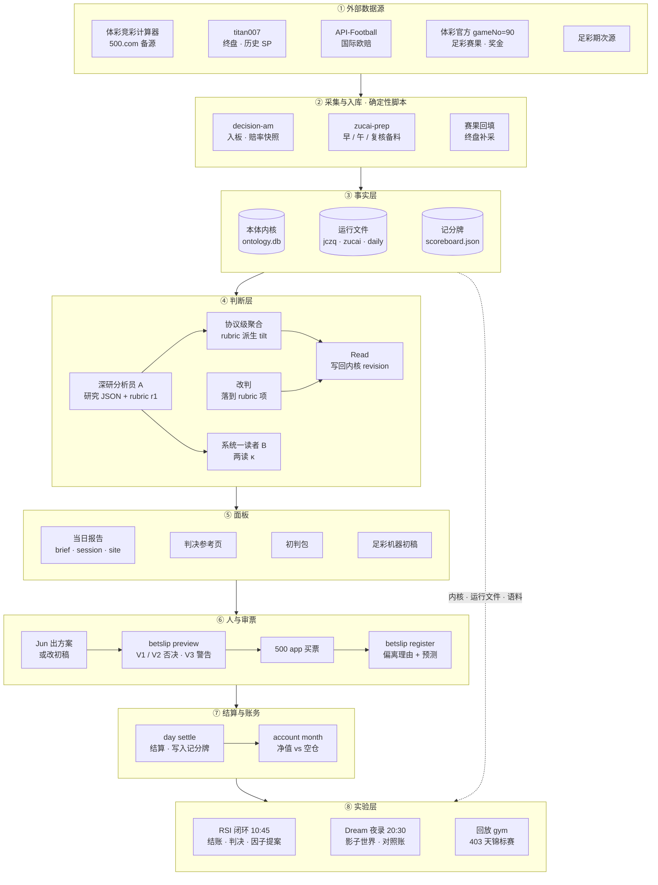
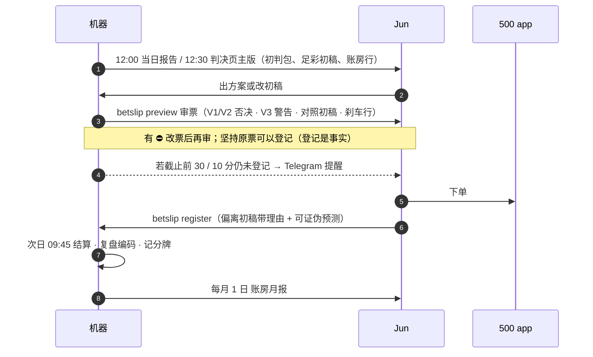
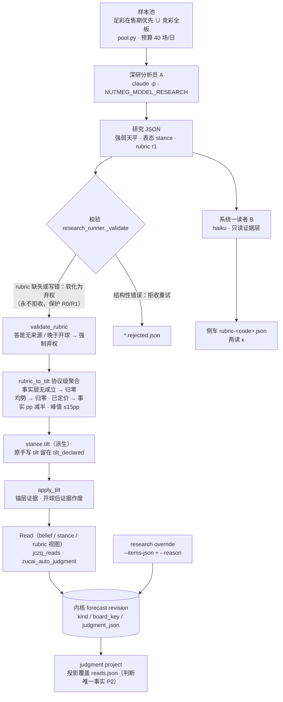
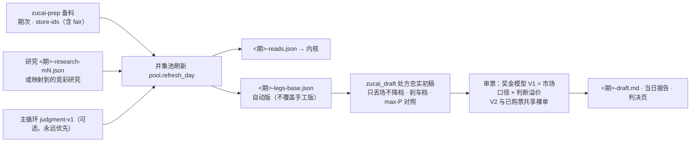
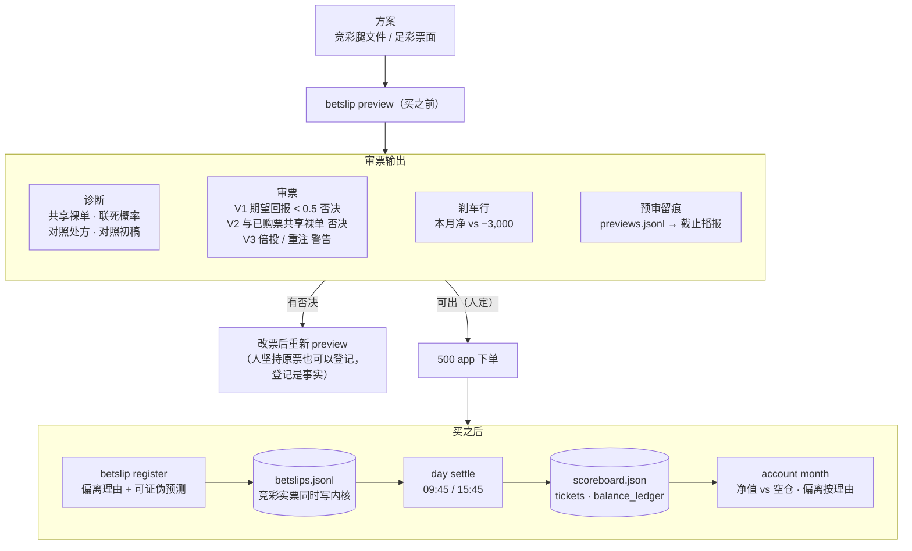
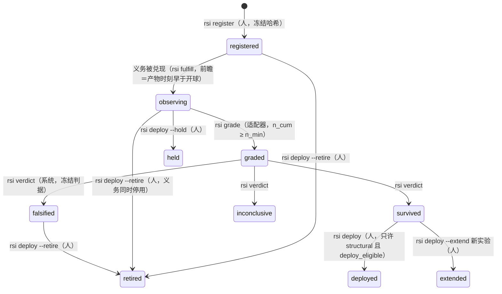
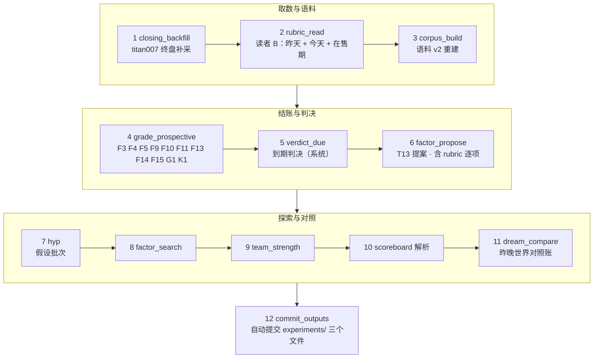
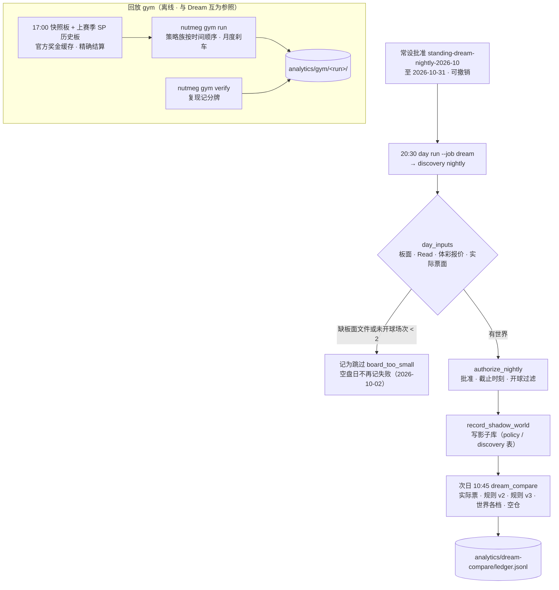
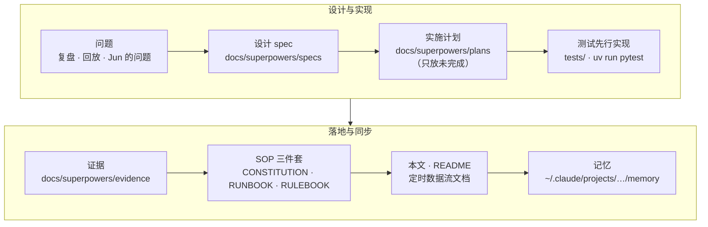

# Nutmeg 结构设计（现役系统 · 2026-10-02）

> 本文是**现役系统的结构总图**：定位、组件、每日数据流、判断层、出票与审票、RSI 实验层、Discovery Harness、数据对象、全量分析过程与工程流程。
> 规则与操作的权威仍是 SOP 三件套（`docs/sop/CONSTITUTION.md` 原则 → `RUNBOOK.md` 执行 → `RULEBOOK.md` 规则）；数字的权威是 `.nutmeg-data/scoreboard.json` 与内核；本文与它们冲突时以它们为准，并回来改本文。
> 维护规则：任何改变组件边界、定时任务、对象或流程的提交，同一提交更新本文对应小节与图。

---

## 0. 一句话与定位

Nutmeg 是中国体彩**竞彩足球（JCZQ）**与**传统足彩（胜负彩 / 任九）**的判断与账务系统。

**2026-10-01 定位（Jun 同意）**：403 天回放证明机器的判断概率≈市场、帽内最大化全对概率的出票形状长期亏损、没有任何策略族在样本外 ROI 为正——**机器不再是最终决策者**。

| 角色 | 谁 | 做什么 |
|---|---|---|
| 风控官 | 机器 | 审票：只否决有实证的坏结构（V1 期望回报 < 0.5、V2 与已购票共享裸单），其余只警告与给数字 |
| 账房 | 机器 | 诚实账本：月净值 vs 空仓、止损线 −¥3,000、偏离初稿按理由结账、判断力指标 |
| 实验员 | 机器 | 预登记实验、逐项结账、证伪；探索预算 ≤¥30/日只给预登记实验 |
| 研究员 | 机器 | 每天对样本池逐场深研，按固定问题表（rubric r1）作答，出初判包；足彩另出**机器初稿** |
| 下注者 | Jun | 出当日方案、改初稿、买票、登记 |

两条元原则（宪法 §3）：**判断永不入脚本**（脚本只做取数、采集、确定性算术）；**判据必须入代码**（没被对象化的知识不参与执行）。

---

## 1. 系统总图

| 层 | 主要代码 | 权威产物 |
|---|---|---|
| 采集 | `nutmeg/decision/fetch.py` `market_data.py` `zucai_prep.py` `scripts/titan007_closing_backfill.py` `scripts/jczq_result_backfill.py` | `jczq/daily/<日>/sporttery_markets.json` `jczq/jc-results.json` `zucai/<期>-issue.json` `zucai/official-*.json` |
| 内核 | `nutmeg/ontology/`（repository / actions / migrations，schema 47） | `.nutmeg-data/ontology/ontology.db` |
| 判断 | `research_runner.py` `research_prompt.py` `rubric_items.py` `rubric.py` `stance.py` `jczq_reads.py` `zucai_auto_judgment.py` `pool.py` `overrides.py` `rubric_reader.py` `judgment_projection.py` | `research-<code>.json` / `<期>-research-m<N>.json`、`reads.json`、`legs-base`、内核 forecast revision |
| 面板 | `day_brief.py` `day_session.py` `day_publish.py` `verdict_page.py` `judgment_brief.py` `zucai_draft.py` `signals.py` | `daily/<日>/brief.md` `session.md`、`site/`、`verdict.html`、`<期>-draft.md` |
| 审票与账务 | `review.py` `review_runner.py` `betslip.py` `betslip_diagnosis.py` `bankroll.py` `account.py` `retro_encoder.py` | `betslips.jsonl` `scoreboard.json` `analytics/account/<月>.md` |
| 实验 | `rsi_loop.py` `rsi_grading.py` `experiments/*.py` `nutmeg/discovery/` `nutmeg/gym/` | 内核 rsi_* 表、`experiments/corpus-v2.json` `factors.json` `registry/`、`analytics/rsi-loop/` |
| 运行 | `day_runner.py` `day_decisions.py` `day_broadcast.py` `day_ops.py` `day_runs.py` `ops_status.py` | `daily/<日>/timeline.json` `decisions.json` `broadcasts.jsonl` |

---

## 2. 每日时序

### 2.1 定时任务

launchd 14 个（plist 单一来源 `ops/launchd/`，装载副本在 `~/Library/LaunchAgents/`），OpenClaw 3 个仍在用。

```mermaid
gantt
  title 每日定时任务（北京时间）
  dateFormat HH:mm
  axisFormat %H:%M
  section 数据
  早盘入板 decision.am（失败 30 分后重试）   :a1, 08:00, 20m
  OpenClaw 昨日内核结算                      :a2, 08:10, 10m
  赛果回填                                   :a3, 09:30, 10m
  赛果回填 二跑                              :a4, 15:30, 10m
  OpenClaw 临场刷板                          :a5, 17:15, 15m
  section 研究与判断
  深研 jczq.research（并集池 ≤40 场）        :b1, 10:00, 40m
  判决页刷新 主版                            :b2, 12:30, 10m
  判决页刷新 晚版                            :b3, 18:45, 10m
  section 足彩备料
  早备料                                     :c1, 11:00, 10m
  午备料                                     :c2, 14:00, 10m
  截止前复核                                 :c3, 18:30, 10m
  section 面板
  当日报告 v1（带模型解释）                  :d1, 12:00, 15m
  当日报告 v2                                :d2, 14:20, 10m
  当日报告 v3                                :d3, 18:35, 10m
  section 结算与实验
  结算 day.settle                            :e1, 09:45, 10m
  结算 二跑                                  :e2, 15:45, 10m
  RSI 闭环 12 步                             :e3, 10:45, 30m
  OpenClaw D1D2 补结算                       :e4, 12:30, 10m
  Dream 夜录                                 :e5, 20:30, 20m
```

| 定时器 | 时刻 | 命令 | 喂给谁 | 断流后果 |
|---|---|---|---|---|
| `decision.am` | 08:00（失败等 30 分重试） | `nutmeg_scheduler_ops.py run-strict --stage am` → `decision-am` | 内核板面、深研、RSI 义务排程 | 当天没有板面；体彩列表**完全为空**记为合法空盘（2026-10-02） |
| `jczq.results-backfill` | 09:30 / 15:30 | `scripts/jczq_result_backfill.py` | `jc-results.json` → 结算、语料、夜账 | 结算与语料停在旧日期（lag>2 天退出 2） |
| `day.settle` | 09:45 / 15:45 | `day run --job results` + `--job settle` | 实票结算、记分牌复盘编码、处方预测记账 | 昨日票未结、账房缺数 |
| `jczq.research` | 10:00 | `decision-am` → `research run` → `research intake --write` → `jczq-build-reads` | 研究文件、Read、内核 revision、足彩自动 legs-base | 判断层零产出；空盘日两步自动跳过 |
| `rsi.loop` | 10:45 | `rsi loop`（12 步，§5.3） | 实验结账、因子提案、Dream 对照账、语料 | 判决与提案停在前一天 |
| `zucai.prep-morning` / `prep` / `prep-revision` | 11:00 / 14:00 / 18:30 | `zucai-prep --slot … --dispatch-telegram` | 足彩期次、store-ids、位移复核 | 足彩样本池与初稿没有输入 |
| `day.brief` | 12:00 / 14:20 / 18:35 | `day run --job brief`（12:00 带模型解释）+ `day publish` | 当日报告、会话入口、站点、足彩初稿自动重建 | `/today` 会话入口与 `/day` 页读到旧报告 |
| `day.verdict` | 12:30 / 18:45 | `research refresh` + `research verdict` | 判决参考页 | 人工裁决看旧页 |
| `day.dream` | 20:30 | `day run --job dream` → `discovery nightly` | Dream 影子世界（常设批准至 2026-10-31） | 当晚世界缺录；空盘记为跳过 |
| `day.broadcast` | 每 10 分 | `day run --job broadcast` | Jun（Telegram） | 截止无人提醒（26130 复发） |
| `rsi.sweep` | 每小时 :00 | `rsi sweep` | F5 / F9 / R0 / R1 的前瞻观察义务 | 加场日义务过期成缺口，不能回补 |
| `account.month` | 每月 1 日 16:10 | `account month --previous --write` | 账房月报 | 月报缺席（可手跑） |

OpenClaw 在用（2026-10-01 起只保留确定性任务，GPT 平行判断链全部停用）：08:10 `decision-settle` 昨日内核结算、12:30 D1/D2 补结算（预演）+ `build-context`、17:15 `run-strict --stage am` 临场刷板。

**已退役**：`zucai.f2-observe`（2026-10-02，随 F2 退役，§5.4）；OpenClaw 收盘 / 每日最终决策 / 早间复盘对齐 / 最终决策补跑 / 收盘前闸门（2026-10-01 停用；真票路径改为 preview → 500 app → register）。

### 2.2 高频任务的设计

| 任务 | 出身 | 设计 | 现状判断 |
|---|---|---|---|
| 截止播报 | 26130 等裁决等到停售，全天工作变空仓 | 每 10 分钟扫一遍「待人决定」，截止前 30 / 10 分钟各发一条，同截止合并；已发不重发 | 2026-10-02 换内容：去掉已不存在的「Read 草稿审批」，只提醒「足彩停售前仍无登记实票」与「竞彩预审过方案却未登记」，每次播报现算 |
| RSI 义务巡检 | RSI 实验进内核后，每场观察义务必须在开球前完成；17:15 加场的比赛覆盖不到 | 每小时跑到期义务的观察仪，过期不回补 | 必须；空跑成本几秒 |
| 让球线观察 | F2 预注册：每期最早开球前一个窗口内录让球线 | 每 15 分钟判一次窗口 | 已退役：冻结窗口内主档样本到不了 n_min，26131 起观察单为空 |

### 2.3 人在哪里介入

---

## 3. 判断层

### 3.1 判断的宪法（strength-v2 + rubric r1）

- **第一序·强弱天平**：判断目标是两队本场的最终强度对比（阵容、本场状态、风格对位、战术剧本、弱势方取胜路径、事件分级）。
- **赔率是噪声识别器**：与价格不一致时必须回答「市场看到了什么我没看到」。
- **第二序·P 定结构**：预算外生，帽内按判断概率定结构；EV 不入决策层（审票的 V1 是风控否决，不是选票目标）。
- **判断契约（rubric r1，2026-10-02）**：程度不再手写 pp。研究层对 16 项类型化问题逐项给「成立概率 + 来源 + 采集时间」，pp＝项目上限×概率由代码派生，上限只许从逐项结账往下调或退役。

### 3.2 研究到 Read 的数据流

要点：

1. **样本池**（并集池，Jun 2026-09-27）：足彩在售期的场次优先，加上竞彩全板；未开球场次的 Read 自动交本体。
2. **研究契约**：`research_prompt.RESEARCH_JSON_CONTRACT` + `rubric_contract()`（问题表由 `rubric_items.question_table()` 生成，契约与代码不会漂移）+ 分析员定义 `.claude/agents/jczq-match-analyst.md`。
3. **rubric r1 问题表**：事实层 7 项（主/客缺阵官宣、停赛、轮换、门将、场地、其他）、结构层 6 项（锚方、中轴完整、弱方路径、平局模态、翻车候选、死面）、价格层 2 项（市场读法、事实已定价）。全文与上限见 RULEBOOK「九」或 `nutmeg rubric items`。
4. **永不因 rubric 拒收**：漏写＝全部弃权（`rubric_missing`），不合法选项改弃权（`rubric_notes`）。
5. **改判**：有 rubric 的研究，改判必须落到项并给封闭理由（新官宣信息 / 证据层级不够 / 已被价格吸收 / 研究自相矛盾 / 回市场），tilt 从合并后的 rubric 重新派生；改判账在判决页按理由分层。
6. **判断唯一事实**：Read 自报 `kind / board_key / code`，内核每个序列取最高 revision 投影回 `reads.json`；手工 `decision-read` 已退役。
7. **两读**：读者 B 只读分析员写下的证据层，逐项作答；κ<0.4 的项要重写或删；B 的整体概率只记账（F9 已证 LLM 整体概率≈市场）。

### 3.3 足彩泳道的 legs-base 与机器初稿

- **自动 legs-base（2026-10-02）**：并集池刷新时为截止当天的期次自动建 legs-base（判断来源与 Read 相同，研究的结构字段与 rubric 经 `research_intake` 转录）；没有 `auto` 标记的手工版一律不动。
- **初稿规则**：处方面集合装进帽，任九 14 选 9 只丢场不降档；装不下才降档，每步砍票内判断概率最低的面并写出。
- **奖金模型**（`scripts/zucai_prize_model.py`）：log(奖金)=a+b·S（S＝按市场概率的全板意外度）；任九 n=41、b=1.007、相关 0.95。b≈1 意味着**市场口径下任何形状的期望回报都≈返奖率**，差别只在判断溢价。

---

## 4. 出票、审票、登记与账务

| 规则 | 内容 | 出处 |
|---|---|---|
| 审票否决 | 只有 V1、V2 两条；人坚持原票可登记 | RULEBOOK「八」，`review.py` |
| 月度止损 | 本月净值 ≤ −¥3,000 → 空仓到月底（只报不拦，登记是事实） | 宪法 §4，`bankroll.py` |
| 探索预算 | ≤¥30/日、只给预登记实验，票面 `--note "EXP:<号>"` | 宪法 §4，`account.py` |
| 偏离登记 | 票面与机器初稿有差异时带理由（自判事实 / 价格直觉 / 资金分配 / 结构偏好 / 其他）+ 一句可证伪预测 | RULEBOOK「九」，`betslip_diagnosis.vs_draft` |
| 结算三源 | 90 分钟口径；竞彩 `jc-results.json`，足彩官方 gameNo=90 | RUNBOOK A7 / B10 |

---

## 5. RSI 实验层

### 5.1 实验生命周期

- 登记原件 `experiments/registry/<ID>.json`（claim / mechanism / window / falsifier / stop_rule / duties），登记后冻结；改冻结字段只能另立新实验。
- **判决只许系统，部署只许人**。退役（2026-10-02 起）同时把该实验的义务置为 retired，排程、到期、巡检都不再列它。
- 「前瞻」的唯一证明：产物时刻早于开球（研究文件 `captured_at`、观察仪产物 mtime）。

### 5.2 实验清单（2026-10-02）

| 实验 | 层 | 问的是什么 | 状态 / n |
|---|---|---|---|
| R0 | 覆盖 | 竞彩全板每场有前瞻深研 | observing 101/200 |
| R1 | 覆盖 | 并集样本池每场有前瞻深研 | observing 37/200 |
| F9 | 判断 | 拨动天平的场次 Brier 优于市场 | observing；残差 −0.2pp CI[−0.9,+0.6] |
| F14 | 判断（主） | 表态面集合命中率高于其市场覆盖率 | registered 0/60 |
| F10 | 判断（主） | 0.60–0.80 热门带命中高于价格 | registered 17/150；+19.5pp CI[+1.8,+32.5] |
| F15 | 判断（主） | 终盘 ≥0.70 大热被低估 | registered 0/100 |
| G1 | 结构（主） | gym 规则 `jczq_fav_pairs` 平注 ROI>0 | registered 0/100 |
| K1 | 判断 | rubric 两读合并 κ ≥ 0.40 | registered 0/100 |
| F3 / F5 / F11 / F13 / F4 / F8 | 结构 / 判断 | 冷热板模态、价格带、保险点名、崩塌叙事、门成本、其他 | 见 `nutmeg rsi status` |
| F2 / F1c | 价格因子 | 让球线位移 / 书商分歧度 | **retired 2026-10-02**（窗口内到不了 n_min） |

`nutmeg rsi status` 是唯一事实源；本表只是快照。

### 5.3 每日闭环（10:45 `rsi loop`）

报告在 `.nutmeg-data/analytics/rsi-loop/<日>.json|md` 与 `latest.md`，「待人决定」进当日报告。

### 5.4 因子注册表（T13）与 rubric 逐项结账

- `experiments/factors.json`：因子分 fact（只记录）与 probability（可测可提案）；**propose 从不写权重**，改权重只许人经 `rsi deploy`。
- 规则：n ≥ 60、只收可证明前瞻的行、高于置换地板、训练窗与测试窗同号才 `propose_change`；够 n 而与地板不可分 → `propose_zero`（证伪路径）。
- **rubric 逐项因子**（11 个 `rubric_<id>`，`experiments/rubric_rows.py`）：行＝{项成立, 效应面开出, 效应面市场价, 前瞻}；只结账在用版本（`SUPPORTED_VERSIONS`）。
- 版本治理：增删项必须先有证据文档 → `RUBRIC_CHANGELOG` → 升版本号 → 退役项写 `until`、新项写 `since`。

### 5.5 语料

`experiments/corpus-v2.json`（2026-10-02：1,665 行，竞彩 1,052、足彩 518、内核 95）由 `experiments/corpus_build.py` 每天重建：判读文件、内核 forecast、titan007 终盘三条泳道合并，`provably_prospective` 由 `nutmeg/decision/prospective.py` 判定。研究标签带 rubric 答案（A）与读者 B 侧车（`rubric_b`，赛后读的标非前瞻）。

---

## 6. Discovery Harness 与 Dream

- **Dream** 每晚把截止时刻未开球的场次与 Jun 的实际票面冻结成一个影子世界；锦标赛、晋级、部署仍只许人。就绪门 `record_to_baseline` 要 30 个封存世界、20 个独立业务日。
- **评估器 v3**（`dream_compare.decision_rule_v3`）：期望回报 < 0.5 否决，过线里取最高，最高 < 1 则规则最优＝空仓。10-31 裁决是否成为唯一规则行。
- **回放 gym**（`nutmeg/gym/`）：17:00 体彩快照板 + 上赛季 SP 历史板 + 官方奖金缓存，精确结算，按时间顺序带月度刹车；`gym verify` 复现记分牌（9 月 −4,721 精确吻合）。

---

## 7. 数据对象

### 7.1 运行文件（`.nutmeg-data/`，gitignored）

| 路径 | 内容 |
|---|---|
| `jczq/daily/<日>/` | `sporttery_markets.json` `jczq-legs-base.json` `reads.json` `research-<code>.json` `rubric-<code>.json` `overrides.jsonl` `closing_odds.json` `signals.md` `verdict.html` `judgment-brief.md` |
| `jczq/jc-results.json` `jc-history.json` `void-matches.json` | 竞彩赛果、上赛季 SP 历史、作废场 |
| `zucai/` | `<期>-issue.json` `-store-ids.json` `-legs-base.json` `-reads.json` `-judgment-v1.json` `-research-m<N>.json` `-rubric-m<N>.json` `-draft.json/.md` `-legs-draft-<渠道>.json`；`official-results.json` `official-prizes.json` `prize-model.json` |
| `daily/<日>/` | `brief.json/md` `session.md` `decisions.json` `timeline.json` `broadcasts.jsonl` `previews.jsonl` `retro.md` `results-90.json` |
| `betslips.jsonl` | 登记簿（实票 / 试玩、诊断、偏离理由、预测） |
| `scoreboard.json` | **记分牌单一事实源**（tickets、balance_ledger、adjudications、链） |
| `ontology/ontology.db` | 本体内核 |
| `analytics/` | `rsi-loop/` `rubric/` `account/` `gym/` `dream-compare/` `team_strength.json` |
| `logs/` | 各定时器的 out/err 日志（状态页按日志时刻判断，不默认它是今天的） |

### 7.2 内核（schema 47，185 张表）

| 表族 | 用途 | 备注 |
|---|---|---|
| `match` `market` `official` `source` `entity` | 身份、报价、官方赛果、来源 | 身份只认显式映射（RULEBOOK g-scope） |
| forecast revisions（schema 47 起带 `kind / board_key / judgment_json`） | 判断唯一事实 | `nutmeg judgment project` 投影 |
| `ticket` `scoreboard` `claim` `factor` | 实票、记分牌镜像、主张、因子 | 竞彩实票由 `betslip register` 写入 |
| `rsi_*`（8） | 实验、义务、观察、结账、判决、部署、修正 | `nutmeg rsi status` |
| `policy_*`（16） `discovery_*`（5） | Dream 影子库同一套迁移 | 不能删 |
| `operator_*`（78） | 旧操作台对象 | 退役专项 2026-10-09（分支 `kernel/operator-retirement`） |

运维规则见 `docs/ontology-kernel-operations.md`。

---

## 8. 全量分析过程（证据链）

每一步都是「复盘或回放 → 证据文档 → 规则或结构变更」，证据在 `docs/superpowers/evidence/`。

| 日期 | 发现 | 结论 → 变更 | 证据 |
|---|---|---|---|
| 07-07 | 旧 tiered/bold/Poisson 引擎无法自证 | M2 切换为决策本体五动词（sense → read → express → reconcile → calibrate） | `specs/2026-07-06-decision-ontology-design.md` |
| 08-23 | 规则散在记忆和聊天里 | 记分牌单一事实源 + SOP 三件套 | `plans/2026-08-23-memory-ontology-sop-redesign.md` |
| 09-18 → 09-22 | 判据从没被逐条结账 | RSI 实验进内核、每日闭环、T13 因子注册表、语料 v2 | `specs/2026-09-18-rsi-experiment-persistence-design.md` `evidence/2026-09-22-rsi-closed-loop-first-run.md` `evidence/2026-09-22-experiment-sample-inventory.md` |
| 09-23 | Read 全抄市场，F9 恒 0 | 研究表态契约 stance | `specs/2026-09-23-research-stance-contract-design.md` |
| 09-26 | 规则太严，帽内连续零解 | strength-v2：强弱天平、赔率作噪声识别器 | `plans/2026-09-26-strength-v2-judgment-overhaul.md` |
| 09-27 | 19 条判断类码无一正向实证 | 规则瘦身：只有正向实证的规则能拦截 | `evidence/2026-09-27-rule-diet.md` |
| 09-30 | 两天表态面 16/16 全对而拨动净负 | 拨动必须有官宣/确证结构证据做锚；F13/F14 登记；登记即诊断、复盘编码器 | `evidence/2026-09-30-project-review-follow-ups.md` |
| 10-01 | GPT 平行链与主循环互不为输入；判断住在多份文件 | 设计系列 8 项：GPT 链停用、真票入内核、评估换轴、判断唯一事实 P0–P2、内核瘦身勘察、身份链、月度止损、Dream v3 | `evidence/2026-10-01-design-series.md` |
| 10-01 | **403 天回放**：帽内 max-P −20%（CI 不含 0）、任九 −58%；大热两两上赛季 −18.8%；大热校准样本外 +4.7pp 但体彩价 ROI −10.9%；实力模型前瞻 null | **定位转向**：机器＝风控官 + 账房 + 实验员，人＝下注者 | `evidence/2026-10-01-replay-gym.md` `evidence/2026-10-01-history-expansion.md` `evidence/2026-10-01-price-edge-validation.md` `evidence/2026-10-01-team-strength-prospective.md` |
| 10-01 | 足彩初稿不能省；任九 P 与中奖奖金反相关 | 机器初稿（处方忠实）+ 奖金模型（b≈1） | `evidence/2026-10-01-design-series.md` §11 |
| 10-02 | 判断的「程度」是手写数字，无法逐项检验 | rubric r1 类型化问题表 + 协议级聚合 + 读者 B 两读 + K1 + 逐项因子 | `specs/2026-10-02-rubric-judgment-contract-design.md` |
| 10-02 | **历史重打分**（260 份研究、190 行有赛果）：公开缺阵 / 门将 / 中轴受损成立时所押方向比市场少中 6–11pp；只有弱方路径 +2.3（n=100）与轮换 +2.4（n=27）为正 | 事实项上限大概率偏高，待前瞻 n≥60 再调；非前瞻，不定权重 | `evidence/2026-10-02-rubric-judgment-contract.md` §6 |
| 10-02 | 改判与人的判断都没有按理由结账 | 改判落到 rubric 项 + 封闭理由；人的偏离登记 + 账房按理由结账；rubric 版本治理 | 同上 §5 |
| 10-02 | 运行层体检：空盘日 Dream/深研崩溃、因子提案会 KeyError、R1 显示为 0、播报内容过时、F2 不可能结账 | 空盘跳过、提案解析 rubric 因子、R1 按观测数、播报换内容、F2/F1c 退役、足彩 legs-base 自动化、早盘空盘不再报失败 | 同上 §7，`evidence/2026-10-02-ops-review.md` |

**当前判断力的诚实读数**：F9（程度判断）残差 −0.2pp、CI 含 0——belief≈市场；结构判断（F14）与热门带（F10/F15）在前瞻结账中；rubric 历史探查显示「公开信息已定价」。系统的产出是**少亏多少 + 证伪了几条**。

---

## 9. 工程流程

- **验证**：`make verify`（ruff + compileall + pytest）；全量约 3 分钟；提交前看真实退出码，不用 `| tail` 吞掉它。
- **提交**：只用显式路径 `git add <path>`，绝不 `-A/-u`；实验输出文件由 10:45 闭环自动提交（`--no-verify`，只提交 `experiments/` 三个文件）。
- **定时器**：plist 单一来源 `ops/launchd/`；新增或退役必须同一提交更新 `day_runs.JOBS`（运行记录页的证据来源）、本文 §2 与 `docs/ops/2026-09-20-scheduled-dataflows.md`。
- **数据**：`.nutmeg-data/` 不进 git；研究原件只读，改判走 `research override`。
- **模型分档**：深研继承默认（opus），逻辑层解释 sonnet，读者 B haiku（`NUTMEG_MODEL_*`）。

---

## 10. 文档地图

| 想知道 | 读 | 状态 |
|---|---|---|
| 现役结构与流程 | 本文 | 权威 |
| 原则、规则、执行 | `docs/sop/CONSTITUTION.md` `RULEBOOK.md` `RUNBOOK.md` | 权威 |
| 定时任务与断流后果 | `docs/ops/2026-09-20-scheduled-dataflows.md` | 权威（2026-10-02 更新） |
| 内核运维 | `docs/ontology-kernel-operations.md` | 权威 |
| 实体知识 | `docs/research/INDEX.md`；画像在 store 的 `profile_notes` | 权威 |
| 某个组件为什么这样设计 | `docs/superpowers/specs/<日>-<主题>-design.md` | 设计时的原件；被后续 spec 或本文取代的部分以后者为准 |
| 某个变更是否落地、数字是多少 | `docs/superpowers/evidence/` | 证据 |
| 工程背景（M1–M6 产品化） | `docs/superpowers/specs/2026-08-24-nutmeg-intelligence-os-design.md` | 历史设计；工作区与治理的思路仍有效，现役结构以本文为准 |
| OpenClaw 时代的调度契约 | `docs/nutmeg-scheduler-operations.md` | 部分过时（见其头注） |
| 2026-07-07 之前的引擎 | tag `v0.4.0` | 已废止，勿据此决策 |
