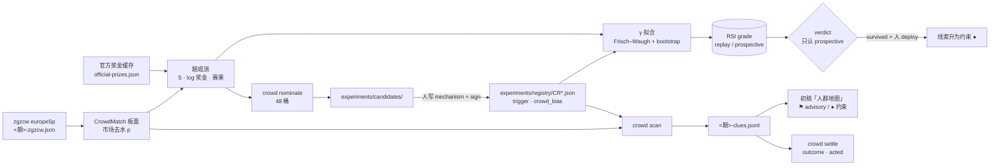

# 足彩人群偏离笔记本 Implementation Plan

> **For agentic workers:** REQUIRED SUB-SKILL: Use superpowers:subagent-driven-development (recommended) or superpowers:executing-plans to implement this plan task-by-task. Steps use checkbox (`- [ ]`) syntax for tracking.

**Goal:** 从全国官方任九奖金反推「人群偏离」，把每条偏离假说做成 `CR` 前缀的 RSI 实验，每期在板面上出线索（Clue）进初稿、赛后结账，机器提名、人签字。

**Architecture:** zgzcw 历史欧赔做统一市场底座（`crowd_source`）→ 封闭 DSL 触发谓词（`crowd_trigger`）→ 奖金残差回归 `log奖金 = a + b·S + γ·X`，γ 的 bootstrap CI 即假说结账（`crowd_model`）→ 线索事件流与人群地图（`crowd_clues`）→ `nutmeg crowd` 命令面 + RSI grade 分支 + 备料/结算/闭环/初稿四处接线。判决仍只认 RSI prospective 档。

**状态（2026-10-07）：** 已执行完毕，只剩 Task 11 Step 3（Jun 签 CR1）。执行记录见文末。

**Tech Stack:** Python 3.12、typer、标准库（无 numpy）、pytest、现有 RSI 内核（SQLite）。

Spec：`docs/superpowers/specs/2026-10-07-zucai-crowd-notebook-design.md`（r2）。

---

## 文件结构

| 文件 | 职责 |
|---|---|
| Create `nutmeg/decision/crowd_source.py` | zgzcw 拉取/解析/快照落盘/回填；`CrowdMatch` |
| Create `nutmeg/decision/crowd_trigger.py` | DSL 校验、(场,面) 事实、求值、触发集合 |
| Create `nutmeg/decision/crowd_model.py` | 期观测、S/X、γ 拟合与 bootstrap、`grade_crowd`、提名 |
| Create `nutmeg/decision/crowd_clues.py` | 扫描出线索、结算、acted、人群地图渲染 |
| Create `nutmeg/interfaces/cli/crowd.py` | `nutmeg crowd …` 七个命令 |
| Modify `nutmeg/interfaces/cli/__init__.py` | 注册 crowd 模块 |
| Modify `nutmeg/ontology/rsi/models.py` | `frozen_hash` 纳入 CR 可选字段（旧哈希不变） |
| Modify `nutmeg/decision/rsi_prereg.py` | CR 原件校验 |
| Modify `nutmeg/interfaces/cli/rsi.py` | `rsi grade` 的 CR 分支 + `--registry-dir` |
| Modify `nutmeg/decision/rsi_wiring.py` | `after_prep` 追加 crowd fetch/scan |
| Modify `nutmeg/decision/day_runner.py` | settle 追加 `crowd settle --pending` |
| Modify `nutmeg/decision/rsi_loop.py` | CR 实验并入结账/判决步 |
| Modify `nutmeg/interfaces/cli/judgment.py` | 初稿末尾追加人群地图 |
| Create `tests/decision/crowd_fixtures.py` | 测试共用：假 zgzcw、假奖金缓存、合成历史 |
| Create tests `tests/decision/test_crowd_{source,trigger,model,clues}.py`、`tests/test_cli_crowd.py` | |
| Modify tests `tests/ontology/test_rsi_models.py`、`tests/decision/test_rsi_wiring.py`、`tests/decision/test_day_runner.py`、`tests/decision/test_rsi_loop.py` | |
| Docs `docs/sop/RUNBOOK.md`、`docs/sop/RULEBOOK.md`、`docs/ARCHITECTURE.md`、`docs/ARCHITECTURE.docx` | |

---

### Task 0: 提交 spec r2

- [x] **Step 1: Commit**

```bash
git add docs/superpowers/specs/2026-10-07-zucai-crowd-notebook-design.md docs/superpowers/plans/2026-10-07-zucai-crowd-notebook.md
git commit -m "docs(specs): crowd notebook r2 — per-match crowd ratios unavailable, infer crowd from official prize residuals; plan"
```

---

### Task 1: `crowd_source` — zgzcw 市场底座

**Files:**
- Create: `nutmeg/decision/crowd_source.py`
- Create: `tests/decision/crowd_fixtures.py`
- Test: `tests/decision/test_crowd_source.py`

- [x] **Step 1: 写测试共用夹具**

```python
# tests/decision/crowd_fixtures.py
"""人群层测试共用：假 zgzcw 文档、假官方奖金缓存、合成历史。"""
from __future__ import annotations

import json
import math
import random
from pathlib import Path

from nutmeg.decision.crowd_source import fetch_issue

# 14 场：(联赛, 主, 客, (主,平,客) 欧赔)
BOARD_ROWS = [
    ("英超", f"主{i}", f"客{i}", odds)
    for i, odds in enumerate([
        (1.50, 4.20, 6.50), (2.40, 3.30, 3.00), (3.10, 3.20, 2.40), (1.80, 3.60, 4.50),
        (2.10, 3.30, 3.60), (2.90, 3.10, 2.60), (1.30, 5.50, 9.00), (2.60, 3.10, 2.90),
        (2.00, 3.40, 3.80), (3.50, 3.40, 2.10), (1.65, 3.90, 5.20), (2.30, 3.20, 3.30),
        (2.80, 3.00, 2.75), (1.95, 3.50, 3.90),
    ], start=1)
]


def zg_doc(rows=BOARD_ROWS) -> dict:
    return {"matchInfo": [
        {"leageName": lg, "hostName": h, "guestName": a, "europeSp": f"{o[0]} {o[1]} {o[2]}",
         "yapan": "0.90 半球 0.90"}
        for lg, h, a, o in rows
    ]}


def write_prizes(zdir: Path, issues: dict[str, dict]) -> None:
    zdir.mkdir(parents=True, exist_ok=True)
    (zdir / "official-prizes.json").write_text(
        json.dumps({"source": "test", "issues": issues}, ensure_ascii=False), encoding="utf-8")


def seed_history(zdir: Path, *, first: int = 26001, n: int = 40, gamma: float = -0.3,
                 seed: int = 3) -> list[str]:
    """合成 n 期：赛果按市场概率抽样，奖金 = exp(-5 + S + gamma·X_draw + 噪声)。"""
    from nutmeg.decision.crowd_model import excess, surprise
    from nutmeg.decision.crowd_source import load_board

    rng = random.Random(seed)
    trigger = {"field": "face", "op": "==", "v": "1"}
    prizes, issues = {}, []
    for k in range(n):
        issue = str(first + k)
        fetch_issue(zdir, issue, fetcher=lambda url: zg_doc())
        _, board = load_board(zdir, issue)
        results = []
        for m in board:
            u, acc = rng.random(), 0.0
            for face in ("3", "1", "0"):
                acc += m.p[face]
                if u <= acc:
                    results.append(face)
                    break
            else:
                results.append("0")
        from nutmeg.decision.crowd_model import IssueObs
        obs = IssueObs(issue, surprise(board, tuple(results)), 0.0, tuple(board), tuple(results))
        log_prize = -5 + obs.s + gamma * excess(trigger, obs) + rng.gauss(0, 0.05)
        prizes[issue] = {"results": " ".join(results),
                         "renjiu": {"stake_count": 10, "stake_amount": round(math.exp(log_prize) * 1e4, 2)}}
        issues.append(issue)
    write_prizes(zdir, prizes)
    return issues
```

- [x] **Step 2: 写失败测试**

```python
# tests/decision/test_crowd_source.py
import json

import pytest

from nutmeg.decision.crowd_source import (
    CrowdMatch, backfill, fetch_issue, load_board, parse_zgzcw,
)
from tests.decision.crowd_fixtures import zg_doc


def test_parse_devigs_and_numbers_matches_in_order():
    board = parse_zgzcw(zg_doc())
    assert len(board) == 14 and [m.no for m in board] == list(range(1, 15))
    m = board[0]
    assert abs(sum(m.p.values()) - 1) < 1e-9 and m.p["3"] > m.p["1"] > m.p["0"]
    assert m.fav_face == "3" and m.league_group == "top5"


def test_parse_skips_bad_rows_but_keeps_numbering():
    doc = zg_doc()
    doc["matchInfo"][1]["europeSp"] = ""
    board = parse_zgzcw(doc)
    assert [m.no for m in board][:2] == [1, 3]


def test_league_groups():
    assert CrowdMatch(1, "欧国联", "a", "b", {"3": .5, "1": .3, "0": .2}).league_group == "national"
    assert CrowdMatch(1, "德乙", "a", "b", {"3": .5, "1": .3, "0": .2}).league_group == "other"


def test_fetch_appends_snapshots_and_load_returns_last(tmp_path):
    times = iter(["2026-10-08T09:00:00+08:00", "2026-10-08T14:00:00+08:00"])
    from datetime import datetime
    for _ in range(2):
        fetch_issue(tmp_path, "26136", fetcher=lambda url: zg_doc(),
                    now=datetime.fromisoformat(next(times)))
    doc = json.loads((tmp_path / "26136-zgzcw.json").read_text("utf-8"))
    assert len(doc["snapshots"]) == 2 and "issue=26136" in doc["source"]
    at, board = load_board(tmp_path, "26136")
    assert at.startswith("2026-10-08T14:00") and len(board) == 14


def test_fetch_refuses_empty_board(tmp_path):
    with pytest.raises(ValueError):
        fetch_issue(tmp_path, "26136", fetcher=lambda url: {"matchInfo": []})
    assert not (tmp_path / "26136-zgzcw.json").exists()


def test_backfill_skips_existing_and_reports_failures(tmp_path):
    fetch_issue(tmp_path, "26035", fetcher=lambda url: zg_doc())

    def fetcher(url):
        if "26037" in url:
            raise OSError("timeout")
        return zg_doc()

    out = backfill(tmp_path, ["26035", "26036", "26037"], fetcher=fetcher, sleep=lambda s: None)
    assert out["26035"] == "skip" and out["26036"] == "ok" and out["26037"].startswith("fail")
```

- [x] **Step 3: Run to verify fail**

Run: `uv run pytest tests/decision/test_crowd_source.py -q`
Expected: FAIL — `ModuleNotFoundError: nutmeg.decision.crowd_source`

- [x] **Step 4: 实现**

```python
# nutmeg/decision/crowd_source.py
"""足彩人群层的市场底座：中国足彩网（zgzcw）胜负彩对阵接口 → 每场市场概率与联赛。

为什么是 zgzcw（2026-10-07 勘察）：500「本站用户投注比例」列已隐藏、popularity JSON 全 404，
zgzcw `renqiInfo` 历史全空——逐场人群比例拿不到，人群改由官方奖金反推（crowd_model）。
反推要求每期同一口径的市场概率：zgzcw `europeSp` 可回取 26035 起全部期次，故全部期次统一用它
（与 500 14:00 快照逐场差最多 8pp，混源会把源差当成人群偏离）。
"""
from __future__ import annotations

import json
import time
import urllib.request
from collections.abc import Callable, Iterable
from dataclasses import dataclass
from datetime import datetime
from pathlib import Path

from nutmeg.gym.board import devig

ZGZCW_URL = "https://cp.zgzcw.com/lottery/zcplayvs.action?lotteryId=13&issue={issue}"
_UA = ("Mozilla/5.0 (Macintosh; Intel Mac OS X 10_15_7) AppleWebKit/537.36 "
       "(KHTML, like Gecko) Chrome/128.0 Safari/537.36")
FACES = ("3", "1", "0")
NATIONAL = frozenset({"友谊赛", "国际赛", "欧国联", "世预赛", "欧预赛", "亚预赛", "世界杯",
                      "欧洲杯", "亚洲杯", "美洲杯", "非洲杯", "金杯赛"})
TOP5 = frozenset({"英超", "西甲", "德甲", "意甲", "法甲"})

Fetcher = Callable[[str], dict]


@dataclass(frozen=True)
class CrowdMatch:
    no: int
    league: str
    home: str
    away: str
    p: dict[str, float]          # {"3","1","0"} 去水市场概率，和为 1
    asian: str = ""

    @property
    def league_group(self) -> str:
        if self.league in NATIONAL:
            return "national"
        return "top5" if self.league in TOP5 else "other"

    @property
    def fav_face(self) -> str:
        return max(FACES, key=lambda f: self.p[f])


def parse_zgzcw(doc: dict) -> list[CrowdMatch]:
    """`matchInfo` 顺序即场号；`europeSp` 缺/坏的场跳过（场号不顺延）。"""
    out = []
    for no, m in enumerate(doc.get("matchInfo") or [], start=1):
        try:
            h, d, a = (float(x) for x in str(m.get("europeSp") or "").split())
            fair = devig({"3": h, "1": d, "0": a})
        except (ValueError, ZeroDivisionError):
            continue
        out.append(CrowdMatch(no=no, league=str(m.get("leageName") or ""),
                              home=str(m.get("hostName") or ""), away=str(m.get("guestName") or ""),
                              p=fair, asian=str(m.get("yapan") or "")))
    return out


def board_path(zdir: Path, issue: str) -> Path:
    return Path(zdir) / f"{issue}-zgzcw.json"


def _default_fetcher(url: str) -> dict:
    req = urllib.request.Request(url, headers={"User-Agent": _UA,
                                               "Accept-Language": "zh-CN,zh;q=0.9"})
    with urllib.request.urlopen(req, timeout=15) as resp:  # noqa: S310 —— 固定 https 源
        return json.loads(resp.read().decode("utf-8"))


def fetch_issue(zdir: Path, issue: str, *, fetcher: Fetcher | None = None,
                now: datetime | None = None) -> Path:
    """拉一次快照追加到 `<期>-zgzcw.json`；无可用对阵时 ValueError、不写文件。"""
    url = ZGZCW_URL.format(issue=issue)
    raw = (fetcher or _default_fetcher)(url)
    if not parse_zgzcw(raw):
        raise ValueError(f"zgzcw {issue} 无可用对阵（matchInfo 空或 europeSp 全缺）")
    path = board_path(zdir, issue)
    doc = (json.loads(path.read_text("utf-8")) if path.exists()
           else {"issue": issue, "source": url, "snapshots": []})
    at = (now or datetime.now().astimezone()).isoformat(timespec="seconds")
    doc["snapshots"].append({"fetched_at": at, "raw": raw})
    path.parent.mkdir(parents=True, exist_ok=True)
    path.write_text(json.dumps(doc, ensure_ascii=False), encoding="utf-8")
    return path


def load_board(zdir: Path, issue: str) -> tuple[str, list[CrowdMatch]] | None:
    """最后一张快照 → (fetched_at, 板面)；无文件/无快照 → None。"""
    path = board_path(zdir, issue)
    if not path.exists():
        return None
    snaps = json.loads(path.read_text("utf-8")).get("snapshots") or []
    if not snaps:
        return None
    return snaps[-1]["fetched_at"], parse_zgzcw(snaps[-1]["raw"])


def backfill(zdir: Path, issues: Iterable[str], *, fetcher: Fetcher | None = None,
             sleep: Callable[[float], None] = time.sleep, pause: float = 1.0) -> dict[str, str]:
    """逐期回取；已有快照跳过；单期失败只记账不中断。→ {期: ok|skip|fail: …}"""
    out: dict[str, str] = {}
    for issue in issues:
        if load_board(zdir, issue):
            out[issue] = "skip"
            continue
        try:
            fetch_issue(zdir, issue, fetcher=fetcher)
            out[issue] = "ok"
        except (OSError, ValueError) as exc:
            out[issue] = f"fail: {exc}"[:120]
        sleep(pause)
    return out
```

- [x] **Step 5: Run to verify pass**

Run: `uv run pytest tests/decision/test_crowd_source.py -q`
Expected: 6 passed

- [x] **Step 6: 核对 zgzcw 场序 = 体彩场号（生产数据，只读）**

```bash
uv run python - <<'EOF'
import json
from nutmeg.decision.crowd_source import parse_zgzcw, _default_fetcher, ZGZCW_URL
for issue in ("26134", "26135"):
    board = parse_zgzcw(_default_fetcher(ZGZCW_URL.format(issue=issue)))
    ours = {m["match_no"]: m for m in json.load(open(f".nutmeg-data/zucai/{issue}-issue.json"))["matches"]}
    for m in board:
        print(issue, m.no, m.home, "|", ours[m.no]["home_team"], m.away, "|", ours[m.no]["away_team"])
EOF
```
Expected: 每行两侧主客队为同一对阵（简称差异可接受）。若顺序错位，停下来改 `parse_zgzcw` 按名字对齐，再继续。

- [x] **Step 7: Commit**

```bash
git add nutmeg/decision/crowd_source.py tests/decision/crowd_fixtures.py tests/decision/test_crowd_source.py
git commit -m "feat(crowd): zgzcw market base — parse/devig, append-only snapshots, backfill"
```

---

### Task 2: `crowd_trigger` — 封闭 DSL

**Files:**
- Create: `nutmeg/decision/crowd_trigger.py`
- Test: `tests/decision/test_crowd_trigger.py`

- [x] **Step 1: 写失败测试**

```python
# tests/decision/test_crowd_trigger.py
import pytest

from nutmeg.decision.crowd_source import parse_zgzcw
from nutmeg.decision.crowd_trigger import evaluate, facts, fires, validate
from tests.decision.crowd_fixtures import zg_doc

BOARD = parse_zgzcw(zg_doc())


def test_validate_accepts_nested_and_rejects_unknowns():
    validate({"all": [{"field": "face", "op": "==", "v": "1"},
                      {"not": {"field": "league_group", "op": "in", "v": ["national"]}}]})
    with pytest.raises(ValueError, match="未知字段"):
        validate({"field": "gap", "op": ">=", "v": 1})
    with pytest.raises(ValueError):
        validate({"field": "face", "op": "~", "v": "1"})
    with pytest.raises(ValueError, match="列表"):
        validate({"field": "league", "op": "in", "v": "英超"})
    with pytest.raises(ValueError, match="嵌套"):
        validate({"all": [{"any": [{"not": {"field": "face", "op": "==", "v": "1"}}]}]})


def test_facts_units_are_percent_and_board_hot_count():
    f = facts(BOARD[6], "3", BOARD)          # 1.30 的主胜
    assert f["p_face"] > 65 and f["is_fav"] is True and f["fav_face"] == "3"
    assert f["board_hot_count"] == sum(1 for m in BOARD if max(m.p.values()) >= 0.65)
    assert f["league_group"] == "top5"


def test_evaluate_and_fires():
    draw = {"field": "face", "op": "==", "v": "1"}
    assert fires(draw, BOARD) == [(m.no, "1") for m in BOARD]
    hot_home = {"all": [{"field": "face", "op": "==", "v": "3"}, {"field": "p_face", "op": ">=", "v": 65}]}
    assert {no for no, _ in fires(hot_home, BOARD)} == {m.no for m in BOARD if m.p["3"] >= 0.65}
    assert evaluate({"not": draw}, facts(BOARD[0], "0", BOARD)) is True
```

- [x] **Step 2: Run to verify fail**

Run: `uv run pytest tests/decision/test_crowd_trigger.py -q`
Expected: FAIL — `ModuleNotFoundError`

- [x] **Step 3: 实现**

```python
# nutmeg/decision/crowd_trigger.py
"""人群假说的触发谓词：封闭字段集，粒度 = (场, 面)。不在集合里的字段一律拒绝（登记时就炸）。"""
from __future__ import annotations

from nutmeg.decision.crowd_source import FACES, CrowdMatch

FIELDS = frozenset({"face", "p_face", "p_home", "p_draw", "p_away", "fav_face", "is_fav",
                    "league", "league_group", "board_hot_count"})
OPS = frozenset({">=", "<=", "==", "in", "not_in"})
MAX_DEPTH = 2
HOT = 0.65


def validate(node: dict, depth: int = 0) -> None:
    if not isinstance(node, dict) or not node:
        raise ValueError(f"trigger 节点必须是非空对象：{node!r}")
    for key in ("all", "any"):
        if key in node:
            if depth >= MAX_DEPTH:
                raise ValueError(f"trigger 嵌套超过 {MAX_DEPTH} 层")
            kids = node[key]
            if not isinstance(kids, list) or not kids:
                raise ValueError(f"{key} 必须是非空列表")
            for kid in kids:
                validate(kid, depth + 1)
            return
    if "not" in node:
        if depth >= MAX_DEPTH:
            raise ValueError(f"trigger 嵌套超过 {MAX_DEPTH} 层")
        validate(node["not"], depth + 1)
        return
    if set(node) != {"field", "op", "v"}:
        raise ValueError(f"叶子必须恰为 field/op/v：{node!r}")
    if node["field"] not in FIELDS:
        raise ValueError(f"未知字段 {node['field']!r}；可用 {sorted(FIELDS)}")
    if node["op"] not in OPS:
        raise ValueError(f"未知运算符 {node['op']!r}；可用 {sorted(OPS)}")
    if node["op"] in ("in", "not_in") and not isinstance(node["v"], list):
        raise ValueError("in/not_in 的 v 必须是列表")


def facts(match: CrowdMatch, face: str, board: list[CrowdMatch]) -> dict:
    """(场, 面) 的可触发事实；概率单位 %。"""
    return {
        "face": face,
        "p_face": round(100 * match.p[face], 2),
        "p_home": round(100 * match.p["3"], 2),
        "p_draw": round(100 * match.p["1"], 2),
        "p_away": round(100 * match.p["0"], 2),
        "fav_face": match.fav_face,
        "is_fav": face == match.fav_face,
        "league": match.league,
        "league_group": match.league_group,
        "board_hot_count": sum(1 for m in board if max(m.p.values()) >= HOT),
    }


def evaluate(node: dict, f: dict) -> bool:
    if "all" in node:
        return all(evaluate(kid, f) for kid in node["all"])
    if "any" in node:
        return any(evaluate(kid, f) for kid in node["any"])
    if "not" in node:
        return not evaluate(node["not"], f)
    left, op, v = f[node["field"]], node["op"], node["v"]
    if op == ">=":
        return left >= v
    if op == "<=":
        return left <= v
    if op == "==":
        return left == v
    if op == "in":
        return left in v
    return left not in v


def fires(trigger: dict, board: list[CrowdMatch]) -> list[tuple[int, str]]:
    return [(m.no, face) for m in board for face in FACES
            if evaluate(trigger, facts(m, face, board))]
```

- [x] **Step 4: Run to verify pass**

Run: `uv run pytest tests/decision/test_crowd_trigger.py -q`
Expected: 3 passed

- [x] **Step 5: Commit**

```bash
git add nutmeg/decision/crowd_trigger.py tests/decision/test_crowd_trigger.py
git commit -m "feat(crowd): closed trigger DSL over (match, face) facts"
```

---

### Task 3: `crowd_model` — 奖金残差 γ、结账、提名

**Files:**
- Create: `nutmeg/decision/crowd_model.py`
- Test: `tests/decision/test_crowd_model.py`

- [x] **Step 1: 写失败测试**

```python
# tests/decision/test_crowd_model.py
from nutmeg.decision.crowd_model import (
    IssueObs, bucket_triggers, excess, fit_gamma, grade_crowd, load_observations, nominate,
)
from nutmeg.decision.crowd_source import parse_zgzcw
from tests.decision.crowd_fixtures import seed_history, zg_doc

DRAW = {"field": "face", "op": "==", "v": "1"}


def test_excess_is_realised_minus_market_expected():
    board = tuple(parse_zgzcw(zg_doc()))
    results = tuple(["1"] * 3 + ["3"] * 11)
    obs = IssueObs("x", 0.0, 0.0, board, results)
    expected = 3 - sum(m.p["1"] for m in board)
    assert abs(excess(DRAW, obs) - expected) < 1e-9
    void = IssueObs("x", 0.0, 0.0, board, tuple(["*"] + list(results[1:])))
    assert abs(excess(DRAW, void) - (2 - sum(m.p["1"] for m in board[1:]))) < 1e-9


def test_fit_recovers_known_gamma(tmp_path):
    seed_history(tmp_path, n=60, gamma=-0.3)
    fit = fit_gamma(load_observations(tmp_path), DRAW, boots=400)
    assert fit.n == 60 and abs(fit.gamma + 0.3) < 0.05 and fit.ci_high < 0


def test_window_filter_and_requirements(tmp_path):
    issues = seed_history(tmp_path, n=10)
    obs = load_observations(tmp_path, window={"issue_from": issues[2], "issue_to": issues[5]})
    assert [o.issue for o in obs] == issues[2:6]


def test_grade_sign_follows_crowd_bias(tmp_path):
    seed_history(tmp_path, n=40, gamma=-0.3)
    doc = {"exp_id": "CR9", "trigger": DRAW, "crowd_bias": "over",
           "window": {"issue_from": "26001", "issue_to": "26999"},
           "replay_window": {"issue_from": "26001", "issue_to": "26020"}}
    g = grade_crowd(doc, tmp_path, mode="prospective", boots=300)
    assert g.n_cum == 40 and g.metric_value_pp > 0 and g.ci_low_pp > 0   # over + γ<0 → 方向成立
    assert g.ci_low_pp <= g.metric_value_pp <= g.ci_high_pp
    r = grade_crowd(doc, tmp_path, mode="replay", boots=300)
    assert r.n_cum == 20 and r.inputs_hash != g.inputs_hash
    doc["crowd_bias"] = "under"
    assert grade_crowd(doc, tmp_path, mode="prospective", boots=300).ci_high_pp < 0


def test_grade_with_too_few_issues_is_flat(tmp_path):
    seed_history(tmp_path, n=2)
    doc = {"exp_id": "CR9", "trigger": DRAW, "crowd_bias": "over",
           "window": {"issue_from": "26001", "issue_to": "26999"}, "replay_window": {}}
    g = grade_crowd(doc, tmp_path, mode="prospective")
    assert g.n_cum == 2 and (g.metric_value_pp, g.ci_low_pp, g.ci_high_pp) == (0.0, 0.0, 0.0)


def test_replay_without_window_has_no_sample(tmp_path):
    seed_history(tmp_path, n=10)
    doc = {"exp_id": "CR9", "trigger": DRAW, "crowd_bias": "over",
           "window": {"issue_from": "26001", "issue_to": "26999"}, "replay_window": None}
    assert grade_crowd(doc, tmp_path, mode="replay").n_cum == 0


def test_bucket_grammar_has_48_buckets():
    assert len(bucket_triggers()) == 48


def test_nominate_finds_planted_draw_effect_and_skips_registered(tmp_path):
    seed_history(tmp_path, n=60, gamma=-0.4)
    obs = load_observations(tmp_path)
    # top=48：只验「植入的平局效应被提名且方向对」，不赌它在 |γ| 排序里排第一
    # （各面 X 之和恒为 0，主/客桶会带出相关的伪信号）。
    cands = nominate(obs, existing={}, top=48, boots=300)
    draw = [c for c in cands if c["trigger"] == DRAW]
    assert draw and draw[0]["crowd_bias"] == "over"
    assert draw[0]["evidence"]["buckets_scanned"] == 48
    again = nominate(obs, existing={"CR1": DRAW}, top=48, boots=300)
    assert all(c["trigger"] != DRAW for c in again)
```

- [x] **Step 2: Run to verify fail**

Run: `uv run pytest tests/decision/test_crowd_model.py -q`
Expected: FAIL — `ModuleNotFoundError`

- [x] **Step 3: 实现**

```python
# nutmeg/decision/crowd_model.py
"""官方奖金反推人群：log 任九奖金 = a + b·S + γ·X。

S = −Σ ln p(实际赛果)（市场意外度，非作废场）；X = 触发面「实开数 − 市场期望数」。
γ>0：触发面开出时奖池多付 → 全国人群少买它；γ<0：人群多买。估计用 Frisch–Waugh 两步 OLS，
按期 bootstrap 取 CI。观测单位是期——每期只有一个奖金。
"""
from __future__ import annotations

import hashlib
import json
import math
import random
import statistics
from dataclasses import dataclass
from pathlib import Path

from nutmeg.decision.crowd_source import FACES, CrowdMatch, load_board
from nutmeg.decision.crowd_trigger import evaluate, facts, fires
from nutmeg.decision.rsi_grading import GradeResult
from nutmeg.gym.prizes import load_prizes

N_MATCHES = 14
BOOTS = 2000
BANDS = ((0, 20), (20, 35), (35, 50), (50, 65), (65, 101))
GROUPS = ("national", "top5", "other")
_FACE_CN = {"3": "主胜", "1": "平局", "0": "客胜"}
_GROUP_CN = {"national": "国家队", "top5": "五大联赛", "other": "其他联赛"}


@dataclass(frozen=True)
class IssueObs:
    issue: str
    s: float
    log_prize: float
    board: tuple[CrowdMatch, ...]
    results: tuple[str, ...]          # 按场号 1..14："3"/"1"/"0"/"*"


@dataclass(frozen=True)
class GammaFit:
    n: int
    gamma: float
    ci_low: float
    ci_high: float
    issues: tuple[str, ...]
    rows: tuple[tuple[float, float, float], ...]


def surprise(board, results) -> float:
    return sum(-math.log(m.p[results[m.no - 1]]) for m in board if results[m.no - 1] != "*")


def _in_window(issue: str, window: dict | None) -> bool:
    if not window:
        return True
    lo, hi = window.get("issue_from"), window.get("issue_to")
    return (not lo or issue >= str(lo)) and (not hi or issue <= str(hi))


def load_observations(zdir: Path, *, window: dict | None = None) -> list[IssueObs]:
    """官方任九有人中奖、赛果 14 场、zgzcw 板面 14 场齐全的期。"""
    out = []
    for issue, row in sorted(load_prizes(zdir).items()):
        if not _in_window(issue, window):
            continue
        prize = (row.get("renjiu") or {}).get("stake_amount")
        results = tuple(str(row.get("results") or "").split())
        loaded = load_board(zdir, issue)
        if not prize or prize <= 0 or len(results) != N_MATCHES or loaded is None:
            continue
        board = tuple(loaded[1])
        if len(board) != N_MATCHES:
            continue
        out.append(IssueObs(issue, surprise(board, results), math.log(prize), board, results))
    return out


def excess(trigger: dict, obs: IssueObs) -> float:
    board = list(obs.board)
    total = 0.0
    for m in board:
        actual = obs.results[m.no - 1]
        if actual == "*":
            continue
        hit = {face: evaluate(trigger, facts(m, face, board)) for face in FACES}
        total += (1.0 if hit[actual] else 0.0) - sum(m.p[f] for f in FACES if hit[f])
    return total


def _ols(xs: list[float], ys: list[float]) -> tuple[float, float]:
    mx, my = statistics.fmean(xs), statistics.fmean(ys)
    sxx = sum((x - mx) ** 2 for x in xs)
    if sxx == 0:
        return my, 0.0
    b = sum((x - mx) * (y - my) for x, y in zip(xs, ys, strict=True)) / sxx
    return my - b * mx, b


def _gamma(rows) -> float:
    s = [r[0] for r in rows]
    y = [r[1] for r in rows]
    x = [r[2] for r in rows]
    ay, by = _ols(s, y)
    ax, bx = _ols(s, x)
    ry = [yi - (ay + by * si) for yi, si in zip(y, s, strict=True)]
    rx = [xi - (ax + bx * si) for xi, si in zip(x, s, strict=True)]
    return _ols(rx, ry)[1]


def fit_gamma(observations: list[IssueObs], trigger: dict, *, seed: int = 7,
              boots: int = BOOTS) -> GammaFit:
    rows = tuple((o.s, o.log_prize, excess(trigger, o)) for o in observations)
    issues = tuple(o.issue for o in observations)
    if len(rows) < 3:
        return GammaFit(len(rows), 0.0, 0.0, 0.0, issues, rows)
    rng = random.Random(seed)
    draws = sorted(_gamma([rng.choice(rows) for _ in rows]) for _ in range(boots))
    return GammaFit(len(rows), _gamma(rows), draws[int(0.025 * boots)],
                    draws[int(0.975 * boots) - 1], issues, rows)


def grade_crowd(doc: dict, zdir: Path, *, mode: str, seed: int = 7,
                boots: int = BOOTS) -> GradeResult:
    """metric = sign·γ·100（每多开一个触发面奖金变化 %）；正数 = 假说方向成立。"""
    window = doc.get("replay_window") if mode == "replay" else doc["window"]
    # 没有窗口就没有样本——绝不退化成「全部期次」（那会把提名块混进验证）。
    observations = load_observations(zdir, window=window) if window else []
    fit = fit_gamma(observations, doc["trigger"], seed=seed, boots=boots)
    sign = 1.0 if doc["crowd_bias"] == "under" else -1.0
    lo, hi = sorted((sign * fit.ci_low * 100, sign * fit.ci_high * 100))
    raw = json.dumps({"exp": doc["exp_id"], "mode": mode, "issues": fit.issues,
                      "rows": fit.rows}, separators=(",", ":")).encode()
    return GradeResult(
        stratum="zucai", n_cum=fit.n, metric_value_pp=round(sign * fit.gamma * 100, 3) + 0.0,
        ci_low_pp=round(lo, 3) + 0.0, ci_high_pp=round(hi, 3) + 0.0, cost_axis_pp=None,
        as_of_policy="per_issue_official_renjiu_prize",
        inputs_hash=hashlib.sha256(raw).hexdigest(),
        computed_by="nutmeg.decision.crowd_model.grade_crowd", selected_keys=fit.issues)


def bucket_triggers() -> list[tuple[str, dict]]:
    """提名文法：3 个纯面桶 + 面 × 市场档 × 联赛组 45 桶 = 48。"""
    out = []
    for face in FACES:
        is_face = {"field": "face", "op": "==", "v": face}
        out.append((_FACE_CN[face], is_face))
        for lo, hi in BANDS:
            for group in GROUPS:
                out.append((f"{_GROUP_CN[group]}·{_FACE_CN[face]}·市场 {lo}–{min(hi, 100)}%",
                            {"all": [is_face,
                                     {"field": "p_face", "op": ">=", "v": lo},
                                     {"field": "p_face", "op": "<=", "v": hi - 0.01},
                                     {"field": "league_group", "op": "==", "v": group}]}))
    return out


def _fire_set(trigger: dict, observations: list[IssueObs]) -> set[tuple[str, int, str]]:
    return {(o.issue, no, face) for o in observations for no, face in fires(trigger, list(o.board))}


def nominate(observations: list[IssueObs], *, existing: dict[str, dict], top: int = 3,
             seed: int = 7, boots: int = BOOTS) -> list[dict]:
    """扫 48 桶：CI 不含 0 的按 |γ| 取前 top；与已登记触发集合重叠 ≥50% 的不提。"""
    taken = [s for s in (_fire_set(t, observations) for t in existing.values()) if s]
    buckets = bucket_triggers()
    found = []
    for label, trigger in buckets:
        fset = _fire_set(trigger, observations)
        if not fset or any(len(fset & s) >= 0.5 * len(fset) for s in taken):
            continue
        fit = fit_gamma(observations, trigger, seed=seed, boots=boots)
        if fit.n < 3 or fit.ci_low <= 0 <= fit.ci_high:
            continue
        found.append((abs(fit.gamma), label, trigger, fit))
    found.sort(key=lambda r: -r[0])
    out = []
    for _, label, trigger, fit in found[:top]:
        bias = "under" if fit.gamma > 0 else "over"
        out.append({
            "label_cn": f"全国人群{'少买' if bias == 'under' else '多买'}{label}",
            "trigger": trigger, "crowd_bias": bias,
            "evidence": {"window": [fit.issues[0], fit.issues[-1]], "n": fit.n,
                         "gamma_pct": round(fit.gamma * 100, 2),
                         "ci_pct": [round(fit.ci_low * 100, 2), round(fit.ci_high * 100, 2)],
                         "buckets_scanned": len(buckets)},
        })
    return out
```

- [x] **Step 4: Run to verify pass**

Run: `uv run pytest tests/decision/test_crowd_model.py -q`
Expected: 8 passed（若 `test_fit_recovers_known_gamma` 的容差在固定 seed 下不过，检查 `seed_history` 的抽样，不得放宽到 >0.08）

- [x] **Step 5: Commit**

```bash
git add nutmeg/decision/crowd_model.py tests/decision/test_crowd_model.py
git commit -m "feat(crowd): prize-residual crowd model — S/X, Frisch–Waugh gamma with bootstrap CI, grade + 48-bucket nominator"
```

---

### Task 4: RSI 契约 — CR 原件校验与冻结哈希

**Files:**
- Modify: `nutmeg/ontology/rsi/models.py`（`FROZEN_FIELDS` 之后、`frozen_hash`）
- Modify: `nutmeg/decision/rsi_prereg.py`（`load_registry_doc` 末尾）
- Test: `tests/ontology/test_rsi_models.py`、`tests/decision/test_crowd_prereg.py`

- [x] **Step 1: 写失败测试**

追加到 `tests/ontology/test_rsi_models.py`：

```python
def test_frozen_hash_unchanged_for_docs_without_crowd_fields():
    import hashlib
    import json
    from pathlib import Path

    from nutmeg.ontology.actions.models import canonical_json
    from nutmeg.ontology.rsi.models import FROZEN_FIELDS, frozen_hash

    for path in sorted(Path("experiments/registry").glob("[!_C]*.json")):
        doc = json.loads(path.read_text("utf-8"))
        old = hashlib.sha256(canonical_json({k: doc.get(k) for k in FROZEN_FIELDS})
                             .encode("utf-8")).hexdigest()
        assert frozen_hash(doc) == old, path.name


def test_frozen_hash_covers_crowd_fields_when_present():
    from nutmeg.ontology.rsi.models import frozen_hash

    base = {"exp_id": "CR1", "claim": "c", "trigger": {"field": "face", "op": "==", "v": "1"},
            "crowd_bias": "over", "label_cn": "x", "replay_window": {"issue_from": "1", "issue_to": "2"}}
    flipped = dict(base, trigger={"field": "face", "op": "==", "v": "3"})
    assert frozen_hash(base) != frozen_hash(flipped)
    assert frozen_hash(base) == frozen_hash(dict(base, psychology="随便改"))
```

新建 `tests/decision/test_crowd_prereg.py`：

```python
import json

import pytest

from nutmeg.decision.rsi_prereg import load_registry_doc

CR = {
    "exp_id": "CR1", "claim": "c", "mechanism": "m", "tier": "deploy_eligible", "layer": "structural",
    "population": "zucai", "min_tier": "price_only",
    "window": {"issue_from": "26136", "issue_to": "26999"},
    "replay_window": {"issue_from": "26035", "issue_to": "26089"},
    "falsifier": {"metric": "crowd_prize_pct_per_face", "stratum": "zucai", "n_min": 30,
                  "bound": "ci_lower", "threshold_pp": 0.0, "direction": "lt_means_falsified"},
    "stop_rule": "s", "quota_slot": False, "buckets": [], "rule_ids": [],
    "source_doc": "docs/superpowers/specs/2026-10-07-zucai-crowd-notebook-design.md",
    "registered_at": "2026-10-07", "label_cn": "全国人群多买平局",
    "trigger": {"field": "face", "op": "==", "v": "1"}, "crowd_bias": "over",
}


def _load(tmp_path, doc):
    p = tmp_path / "CR1.json"
    p.write_text(json.dumps(doc, ensure_ascii=False), encoding="utf-8")
    return load_registry_doc(p)


def test_valid_cr_doc_loads(tmp_path):
    assert _load(tmp_path, CR)["crowd_bias"] == "over"


@pytest.mark.parametrize("patch, msg", [
    ({"crowd_bias": "maybe"}, "crowd_bias"),
    ({"trigger": {"field": "gap", "op": ">=", "v": 1}}, "未知字段"),
    ({"layer": "judgment", "tier": "observation"}, "structural"),
    ({"replay_window": {"issue_from": "26035"}}, "replay_window"),
])
def test_invalid_cr_doc_is_refused(tmp_path, patch, msg):
    with pytest.raises(ValueError, match=msg):
        _load(tmp_path, dict(CR, **patch))


def test_missing_cr_field_is_refused(tmp_path):
    doc = dict(CR)
    doc.pop("trigger")
    with pytest.raises(ValueError, match="trigger"):
        _load(tmp_path, doc)
```

- [x] **Step 2: Run to verify fail**

Run: `uv run pytest tests/ontology/test_rsi_models.py tests/decision/test_crowd_prereg.py -q`
Expected: FAIL — `test_frozen_hash_covers_crowd_fields_when_present` 与 CR 拒绝类用例失败

- [x] **Step 3: 实现 `frozen_hash`**

`nutmeg/ontology/rsi/models.py`，在 `FROZEN_FIELDS` 元组之后加常量，并替换 `frozen_hash`：

```python
# 人群假说（CR，2026-10-07）的判据字段：只在原件里出现时才进哈希，旧实验的指纹因此不变。
OPTIONAL_FROZEN_FIELDS: tuple[str, ...] = ("label_cn", "trigger", "crowd_bias", "replay_window")


def frozen_hash(doc: dict) -> str:
    """登记原件的冻结指纹。只看 FROZEN_FIELDS（+ 出现了的 OPTIONAL_FROZEN_FIELDS），与字段顺序无关。"""
    material = {k: doc.get(k) for k in FROZEN_FIELDS}
    material.update({k: doc[k] for k in OPTIONAL_FROZEN_FIELDS if k in doc})
    return hashlib.sha256(canonical_json(material).encode("utf-8")).hexdigest()
```

- [x] **Step 4: 实现 CR 校验**

`nutmeg/decision/rsi_prereg.py`：顶部常量区加

```python
_CR_REQUIRED = ("label_cn", "trigger", "crowd_bias", "replay_window")
```

在 `load_registry_doc` 的 `return doc` 之前插入：

```python
    if str(doc["exp_id"]).startswith("CR"):
        _validate_crowd(doc)
```

文件末尾加：

```python
def _validate_crowd(doc: dict) -> None:
    """人群假说（CR）：结构层、带触发谓词与方向、带回放窗。"""
    from nutmeg.decision.crowd_trigger import validate

    missing = [k for k in _CR_REQUIRED if k not in doc]
    if missing:
        raise ValueError(f"CR 原件缺字段: {missing}")
    if doc["crowd_bias"] not in ("under", "over"):
        raise ValueError("crowd_bias 必须是 under/over")
    if doc["layer"] != Layer.STRUCTURAL.value:
        raise ValueError("CR 实验必须是 structural 层（结账靠官方奖金回放，可上线）")
    rw = doc["replay_window"]
    if not isinstance(rw, dict) or not {"issue_from", "issue_to"} <= set(rw):
        raise ValueError("replay_window 必须是 {issue_from, issue_to}")
    validate(doc["trigger"])
```

- [x] **Step 5: Run to verify pass**

Run: `uv run pytest tests/ontology/test_rsi_models.py tests/decision/test_crowd_prereg.py tests/ontology/test_rsi_actions.py -q`
Expected: all passed

- [x] **Step 6: Commit**

```bash
git add nutmeg/ontology/rsi/models.py nutmeg/decision/rsi_prereg.py tests/ontology/test_rsi_models.py tests/decision/test_crowd_prereg.py
git commit -m "feat(rsi): CR registry docs — crowd fields validated and frozen only when present (old hashes unchanged)"
```

---

### Task 5: `rsi grade` 的 CR 分支

**Files:**
- Modify: `nutmeg/interfaces/cli/rsi.py`（`_MODE` 附近加选项；`grade` 函数）
- Test: `tests/test_cli_crowd.py`（新建，本任务只放 grade 用例）

- [x] **Step 1: 写失败测试**

```python
# tests/test_cli_crowd.py
import json
from pathlib import Path

from typer.testing import CliRunner

from nutmeg.interfaces.cli import app
from tests.decision.crowd_fixtures import seed_history
from tests.decision.test_crowd_prereg import CR


def _setup(tmp_path: Path, *, n: int = 30) -> tuple[Path, Path]:
    data = tmp_path / "data"
    seed_history(data / "zucai", first=26001, n=n, gamma=-0.3)
    reg = tmp_path / "registry"
    reg.mkdir()
    doc = dict(CR, window={"issue_from": "26016", "issue_to": "26999"},
               replay_window={"issue_from": "26001", "issue_to": "26015"})
    (reg / "CR1.json").write_text(json.dumps(doc, ensure_ascii=False), encoding="utf-8")
    r = CliRunner().invoke(app, ["rsi", "register", "--by", "Jun", str(reg / "CR1.json"),
                                 "--data-dir", str(data)])
    assert r.exit_code == 0, r.output
    return data, reg


def test_rsi_grade_cr_replay_and_prospective(tmp_path):
    data, reg = _setup(tmp_path)
    for mode, n in (("replay", 15), ("prospective", 15)):
        r = CliRunner().invoke(app, ["rsi", "grade", "--exp", "CR1", "--mode", mode,
                                     "--registry-dir", str(reg), "--data-dir", str(data)])
        assert r.exit_code == 0, r.output
        assert f"CR1 [{mode}] n={n}" in r.output


def test_rsi_grade_cr_refuses_edited_registry_doc(tmp_path):
    data, reg = _setup(tmp_path)
    doc = json.loads((reg / "CR1.json").read_text("utf-8"))
    doc["trigger"] = {"field": "face", "op": "==", "v": "3"}
    (reg / "CR1.json").write_text(json.dumps(doc), encoding="utf-8")
    r = CliRunner().invoke(app, ["rsi", "grade", "--exp", "CR1", "--mode", "replay",
                                 "--registry-dir", str(reg), "--data-dir", str(data)])
    assert r.exit_code != 0 and "冻结指纹" in r.output
```

- [x] **Step 2: Run to verify fail**

Run: `uv run pytest tests/test_cli_crowd.py -q`
Expected: FAIL — `No such option: --registry-dir`

- [x] **Step 3: 实现**

`nutmeg/interfaces/cli/rsi.py`：在 `_MODE = typer.Option(...)` 下一行加

```python
_REGISTRY_DIR = typer.Option(Path("experiments/registry"), "--registry-dir",
                             help="CR 人群假说登记原件目录（结账前核冻结指纹）")
```

`grade` 函数签名改为：

```python
def grade(exp: str = _EXP, mode: str = _MODE, data_dir: Path = _DATA_DIR,
          samples: Path = _SAMPLES_OPT, registry_dir: Path = _REGISTRY_DIR) -> None:
```

在 `if exp == "F2":` 之前插入一个分支（改成 `if exp.startswith("CR"): … elif exp == "F2":`）：

```python
    if exp.startswith("CR"):
        from nutmeg.decision.crowd_model import grade_crowd
        from nutmeg.ontology.rsi.models import frozen_hash

        doc_path = Path(registry_dir) / f"{exp}.json"
        if not doc_path.exists():
            _fail(f"{exp} 登记原件不在 {doc_path}")
        doc = json.loads(doc_path.read_text(encoding="utf-8"))
        if frozen_hash(doc) != e.frozen_hash:
            _fail(f"{exp} 原件与内核冻结指纹不符——改判据请走 rsi amend")
        if mode not in ("replay", "prospective"):
            _fail(f"{exp} 只支持 --mode replay|prospective")
        g = grade_crowd(doc, Path(data_dir) / "zucai", mode=mode)
    elif exp == "F2":
```

- [x] **Step 4: Run to verify pass**

Run: `uv run pytest tests/test_cli_crowd.py tests/test_cli_rsi.py -q`
Expected: all passed

- [x] **Step 5: Commit**

```bash
git add nutmeg/interfaces/cli/rsi.py tests/test_cli_crowd.py
git commit -m "feat(rsi): grade CR crowd hypotheses from official prizes (replay/prospective), refusing edited registry docs"
```

---

### Task 6: `crowd_clues` — 线索、结算、人群地图

**Files:**
- Create: `nutmeg/decision/crowd_clues.py`
- Test: `tests/decision/test_crowd_clues.py`

- [x] **Step 1: 写失败测试**

```python
# tests/decision/test_crowd_clues.py
import json
from datetime import datetime

from nutmeg.decision.crowd_clues import (
    acted, latest_clues, load_registry, read_rows, render_map, scan, settle, ticket_faces,
)
from nutmeg.decision.crowd_source import fetch_issue
from tests.decision.crowd_fixtures import zg_doc

DOCS = {"CR1": {"label_cn": "全国人群多买平局", "trigger": {"field": "face", "op": "==", "v": "1"},
                "crowd_bias": "over"}}


def _board(zdir, at="2026-10-08T09:00:00+08:00"):
    fetch_issue(zdir, "26136", fetcher=lambda url: zg_doc(), now=datetime.fromisoformat(at))


def test_scan_is_idempotent_per_snapshot_and_marks_advisory(tmp_path):
    _board(tmp_path)
    first = scan(tmp_path, "26136", docs=DOCS, deployed=set())
    assert len(first) == 14 and all(c["advisory"] and c["role"] == "fade" for c in first)
    assert scan(tmp_path, "26136", docs=DOCS, deployed=set()) == []
    _board(tmp_path, "2026-10-08T14:00:00+08:00")
    second = scan(tmp_path, "26136", docs=DOCS, deployed={"CR1"})
    assert len(second) == 14 and not any(c["advisory"] for c in second)
    latest = latest_clues(read_rows(tmp_path, "26136"))
    assert {c["snapshot_at"] for c in latest} == {"2026-10-08T14:00:00+08:00"}


def test_latest_clues_follows_last_scan_even_when_empty(tmp_path):
    _board(tmp_path)
    scan(tmp_path, "26136", docs=DOCS, deployed=set())
    _board(tmp_path, "2026-10-08T14:00:00+08:00")
    scan(tmp_path, "26136", docs={}, deployed=set())
    assert latest_clues(read_rows(tmp_path, "26136")) == []


def test_ticket_faces_and_acted(tmp_path):
    slips = tmp_path / "betslips.jsonl"
    slips.write_text("\n".join(json.dumps(s) for s in [
        {"slip_id": "26136-R9-1", "purchased": True,
         "legs": [{"key": "7", "selections": ["home", "draw"]}]},
        {"slip_id": "26135-R9-1", "purchased": True,
         "legs": [{"key": "7", "selections": ["draw"]}]},
        {"slip_id": "26136-T9", "purchased": False,
         "legs": [{"key": "8", "selections": ["draw"]}]},
    ]), encoding="utf-8")
    tickets = ticket_faces(slips, "26136")
    assert tickets == [{7: {"3", "1"}}]
    fade = {"match_no": 7, "face": "1", "role": "fade"}
    assert acted(fade, tickets) == "ignored"
    assert acted(dict(fade, match_no=8), tickets) == "followed"
    assert acted(dict(fade, role="cover"), tickets) == "followed"
    assert acted(fade, []) is None


def test_settle_writes_outcomes_once(tmp_path):
    _board(tmp_path)
    scan(tmp_path, "26136", docs=DOCS, deployed=set())
    results = ["1", "3", "*"] + ["0"] * 11
    rows = settle(tmp_path, "26136", results=results, tickets=[])
    by_no = {r["match_no"]: r["outcome"] for r in rows}
    assert by_no[1] == "hit" and by_no[2] == "miss" and by_no[3] == "void"
    assert settle(tmp_path, "26136", results=results, tickets=[]) == []
    assert settle(tmp_path, "26136", results=None, tickets=[]) == []


def test_render_map_states(tmp_path):
    assert "本期无市场底座" in render_map("26136", [], {}, has_board=False, n_registered=1)
    _board(tmp_path)
    assert "均未触发" in render_map("26136", [], {}, has_board=True, n_registered=1)
    scan(tmp_path, "26136", docs=DOCS, deployed=set())
    text = render_map("26136", read_rows(tmp_path, "26136"),
                      {"CR1": "replay n=55 +4.10% CI[+0.50, +7.70]"}, has_board=True, n_registered=1)
    assert "## 人群地图" in text and "⚑" in text and "fade" in text and "replay n=55" in text


def test_load_registry_only_reads_cr_docs(tmp_path):
    (tmp_path / "CR1.json").write_text(json.dumps(DOCS["CR1"]), encoding="utf-8")
    (tmp_path / "F10.json").write_text("{}", encoding="utf-8")
    assert list(load_registry(tmp_path)) == ["CR1"]
```

- [x] **Step 2: Run to verify fail**

Run: `uv run pytest tests/decision/test_crowd_clues.py -q`
Expected: FAIL — `ModuleNotFoundError`

- [x] **Step 3: 实现**

```python
# nutmeg/decision/crowd_clues.py
"""人群线索：已登记 CR 假说在本期板面上的触发面（`<期>-clues.jsonl`，只追加、不进内核）。

行类型：scan（一次扫描的标记）/ clue（触发面）/ settle（赛后 outcome + acted）。
「最新线索」= 最后一次 scan 那张快照上的 clue 行；最后一次 scan 没触发就是没有线索。
"""
from __future__ import annotations

import json
from pathlib import Path

from nutmeg.decision.crowd_source import load_board
from nutmeg.decision.crowd_trigger import fires

ROLE = {"under": "cover", "over": "fade"}
_CODE = {"home": "3", "draw": "1", "away": "0"}
_FACE_CN = {"3": "主胜", "1": "平", "0": "客胜"}


def clues_path(zdir: Path, issue: str) -> Path:
    return Path(zdir) / f"{issue}-clues.jsonl"


def read_rows(zdir: Path, issue: str) -> list[dict]:
    path = clues_path(zdir, issue)
    if not path.exists():
        return []
    return [json.loads(line) for line in path.read_text("utf-8").splitlines() if line.strip()]


def _append(zdir: Path, issue: str, rows: list[dict]) -> None:
    if not rows:
        return
    Path(zdir).mkdir(parents=True, exist_ok=True)
    with clues_path(zdir, issue).open("a", encoding="utf-8") as fh:
        for row in rows:
            fh.write(json.dumps(row, ensure_ascii=False) + "\n")


def load_registry(registry_dir: Path) -> dict[str, dict]:
    return {p.stem: json.loads(p.read_text("utf-8"))
            for p in sorted(Path(registry_dir).glob("CR*.json"))}


def scan(zdir: Path, issue: str, *, docs: dict[str, dict], deployed: set[str]) -> list[dict]:
    """对最后一张快照跑全部 CR 触发；同 (实验, 场, 面, 快照) 不重写。→ 新写的 clue 行。"""
    loaded = load_board(zdir, issue)
    if loaded is None:
        return []
    snapshot_at, board = loaded
    rows = read_rows(zdir, issue)
    seen = {(r["exp_id"], r["match_no"], r["face"], r["snapshot_at"])
            for r in rows if r.get("kind") == "clue"}
    by_no = {m.no: m for m in board}
    new = []
    for exp_id, doc in sorted(docs.items()):
        for no, face in fires(doc["trigger"], board):
            if (exp_id, no, face, snapshot_at) in seen:
                continue
            m = by_no[no]
            new.append({"kind": "clue", "issue": issue, "snapshot_at": snapshot_at,
                        "exp_id": exp_id, "label_cn": doc.get("label_cn", ""), "match_no": no,
                        "face": face, "p_face": round(100 * m.p[face], 1),
                        "home": m.home, "away": m.away, "crowd_bias": doc["crowd_bias"],
                        "role": ROLE[doc["crowd_bias"]], "advisory": exp_id not in deployed})
    _append(zdir, issue, [{"kind": "scan", "issue": issue, "snapshot_at": snapshot_at,
                           "n_registered": len(docs)}, *new])
    return new


def latest_clues(rows: list[dict]) -> list[dict]:
    scans = [r["snapshot_at"] for r in rows if r.get("kind") == "scan"]
    if not scans:
        return []
    last = max(scans)
    latest: dict[tuple, dict] = {}
    for r in rows:
        if r.get("kind") == "clue" and r["snapshot_at"] == last:
            latest[(r["exp_id"], r["match_no"], r["face"])] = r
    return list(latest.values())


def ticket_faces(betslips: Path, issue: str) -> list[dict[int, set[str]]]:
    """本期已实购的票 → 每张票 {场号: 盖住的面}。按 slip_id 去重，后写为准。"""
    path = Path(betslips)
    if not path.exists():
        return []
    slips: dict[str, dict] = {}
    for line in path.read_text("utf-8").splitlines():
        if line.strip():
            slip = json.loads(line)
            if str(slip.get("slip_id", "")).startswith(f"{issue}-"):
                slips[slip["slip_id"]] = slip
    return [{int(leg["key"]): {_CODE[s] for s in leg.get("selections") or [] if s in _CODE}
             for leg in slip.get("legs") or []}
            for slip in slips.values() if slip.get("purchased")]


def acted(clue: dict, tickets: list[dict[int, set[str]]]) -> str | None:
    if not tickets:
        return None
    covered = any(clue["face"] in t.get(clue["match_no"], set()) for t in tickets)
    if clue["role"] == "cover":
        return "followed" if covered else "ignored"
    return "ignored" if covered else "followed"


def settle(zdir: Path, issue: str, *, results: list[str] | None,
           tickets: list[dict[int, set[str]]]) -> list[dict]:
    """赛果已出才写；同 (实验, 场, 面) 只结一次。"""
    if results is None:
        return []
    rows = read_rows(zdir, issue)
    done = {(r["exp_id"], r["match_no"], r["face"]) for r in rows if r.get("kind") == "settle"}
    out = []
    for clue in latest_clues(rows):
        key = (clue["exp_id"], clue["match_no"], clue["face"])
        if key in done:
            continue
        code = results[clue["match_no"] - 1]
        outcome = "void" if code == "*" else ("hit" if code == clue["face"] else "miss")
        out.append({"kind": "settle", "issue": issue, "exp_id": clue["exp_id"],
                    "match_no": clue["match_no"], "face": clue["face"], "outcome": outcome,
                    "acted": acted(clue, tickets)})
    _append(zdir, issue, out)
    return out


def render_map(issue: str, rows: list[dict], readings: dict[str, str], *, has_board: bool,
               n_registered: int) -> str:
    lines = ["## 人群地图（官方奖金反推）", ""]
    if not has_board:
        return "\n".join([*lines, "本期无市场底座（zgzcw 未取到），无线索。", ""])
    clues = sorted(latest_clues(rows), key=lambda c: (c["match_no"], c["face"], c["exp_id"]))
    lines += ["> 线索 = 已登记 CR 假说在本期板面的触发面。⚑ advisory（未 deploy，只看不用）；"
              "● 约束（已 deploy）。", "> cover：全国人群少买这类面，盖它中了分得多；"
              "fade：人群多买，中了也分得少，别把全包名额花在它上面。", ""]
    if not clues:
        lines.append(f"本期无线索（已登记假说 {n_registered} 条，均未触发）。")
    else:
        lines += ["| 场 | 对阵 | 面 | 市场P | 假说 | 方向 | 状态 | 代价 |",
                  "|---|---|---|---|---|---|---|---|"]
        for c in clues:
            cost = (f"让掉此面：P −{c['p_face']:.1f}pp" if c["role"] == "fade"
                    else "盖上此面：该场多一个选项")
            lines.append(f"| {c['match_no']} | {c['home']}-{c['away']} | {_FACE_CN[c['face']]} | "
                         f"{c['p_face']:.1f}% | {c['exp_id']} {c['label_cn']} | {c['role']} | "
                         f"{'⚑' if c['advisory'] else '●'} | {cost} |")
    if readings:
        lines += ["", "### 各假说读数", ""]
        lines += [f"- {exp}：{text}" for exp, text in sorted(readings.items())]
    return "\n".join([*lines, ""])
```

- [x] **Step 4: Run to verify pass**

Run: `uv run pytest tests/decision/test_crowd_clues.py -q`
Expected: 6 passed

- [x] **Step 5: Commit**

```bash
git add nutmeg/decision/crowd_clues.py tests/decision/test_crowd_clues.py
git commit -m "feat(crowd): clue stream — scan/settle/acted from purchased tickets, crowd map rendering"
```

---

### Task 7: `nutmeg crowd` 命令面

**Files:**
- Create: `nutmeg/interfaces/cli/crowd.py`
- Modify: `nutmeg/interfaces/cli/__init__.py`（注册块按字母序插入 `crowd`）
- Test: `tests/test_cli_crowd.py`（追加）

- [x] **Step 1: 写失败测试**（追加到 `tests/test_cli_crowd.py`）

```python
from nutmeg.interfaces.cli import crowd as crowd_cli
from tests.decision.crowd_fixtures import zg_doc


def test_fetch_scan_map_settle_round_trip(tmp_path, monkeypatch):
    data, reg = _setup(tmp_path)
    monkeypatch.setattr(crowd_cli, "_fetcher", lambda: (lambda url: zg_doc()))
    run = lambda *a: CliRunner().invoke(app, ["crowd", *a, "--data-dir", str(data)])  # noqa: E731
    r = run("fetch", "--issue", "26136")
    assert r.exit_code == 0, r.output
    r = run("scan", "--issue", "26136", "--registry-dir", str(reg))
    assert r.exit_code == 0 and "新线索 14 条" in r.output
    r = run("map", "--issue", "26136", "--registry-dir", str(reg))
    assert "## 人群地图" in r.output and "⚑" in r.output
    prizes = json.loads((data / "zucai" / "official-prizes.json").read_text("utf-8"))
    prizes["issues"]["26136"] = {"results": " ".join(["1"] * 14),
                                 "renjiu": {"stake_count": 1, "stake_amount": 10.0}}
    (data / "zucai" / "official-prizes.json").write_text(json.dumps(prizes), encoding="utf-8")
    monkeypatch.setattr(crowd_cli, "_refresh_prizes", lambda zdir: None)
    r = run("settle", "--pending")
    assert r.exit_code == 0 and "26136 结算 14 条" in r.output


def test_fetch_failure_exits_nonzero(tmp_path, monkeypatch):
    def boom(url):
        raise OSError("timeout")
    monkeypatch.setattr(crowd_cli, "_fetcher", lambda: boom)
    r = CliRunner().invoke(app, ["crowd", "fetch", "--issue", "26136",
                                 "--data-dir", str(tmp_path)])
    assert r.exit_code == 1 and "timeout" in r.output


def test_nominate_writes_candidates_and_sign_registers(tmp_path):
    data = tmp_path / "data"
    seed_history(data / "zucai", first=26001, n=60, gamma=-0.4)
    reg, cand = tmp_path / "registry", tmp_path / "candidates"
    reg.mkdir()
    r = CliRunner().invoke(app, ["crowd", "nominate", "--from", "26001", "--to", "26060",
                                 "--write", "--registry-dir", str(reg),
                                 "--candidates-dir", str(cand), "--data-dir", str(data)])
    assert r.exit_code == 0, r.output
    draw = {"field": "face", "op": "==", "v": "1"}
    paths = [p for p in sorted(cand.glob("CR-cand-*.json"))
             if json.loads(p.read_text("utf-8"))["trigger"] == draw]
    assert paths, r.output
    path = paths[0]
    doc = json.loads(path.read_text("utf-8"))
    assert doc["crowd_bias"] == "over" and doc["mechanism"] == "" and doc["exp_id"] is None
    r = CliRunner().invoke(app, ["crowd", "sign", str(path), "--as", "CR1", "--by", "Jun",
                                 "--from-issue", "26061", "--replay-from", "26001",
                                 "--replay-to", "26030", "--registry-dir", str(reg),
                                 "--data-dir", str(data)])
    assert r.exit_code == 1 and "mechanism" in r.output and not (reg / "CR1.json").exists()
    doc["mechanism"] = "复式拿平局做保险"
    path.write_text(json.dumps(doc, ensure_ascii=False), encoding="utf-8")
    r = CliRunner().invoke(app, ["crowd", "sign", str(path), "--as", "CR1", "--by", "Jun",
                                 "--from-issue", "26061", "--replay-from", "26001",
                                 "--replay-to", "26030", "--registry-dir", str(reg),
                                 "--data-dir", str(data)])
    assert r.exit_code == 0, r.output
    signed = json.loads((reg / "CR1.json").read_text("utf-8"))
    assert signed["exp_id"] == "CR1" and signed["window"]["issue_from"] == "26061"
    assert "已登记 CR1" in r.output
```

- [x] **Step 2: Run to verify fail**

Run: `uv run pytest tests/test_cli_crowd.py -q`
Expected: FAIL — `No such command 'crowd'`

- [x] **Step 3: 实现 CLI**

```python
# nutmeg/interfaces/cli/crowd.py
"""足彩人群偏离笔记本：`nutmeg crowd fetch/backfill/scan/map/settle/nominate/sign`。

设计见 docs/superpowers/specs/2026-10-07-zucai-crowd-notebook-design.md。全部只追加、幂等；
判决不在这里——CR 假说的结账/判决/上线走 `nutmeg rsi grade|verdict|deploy`。
"""
from __future__ import annotations

import json
from datetime import date
from pathlib import Path

import typer

import nutmeg.interfaces.cli as _cli

crowd_app = typer.Typer(help="足彩人群偏离笔记本：市场底座 / 线索 / 结算 / 提名 / 签字")
_cli.app.add_typer(crowd_app, name="crowd")

_DATA_DIR = typer.Option(Path(".nutmeg-data"), "--data-dir")
_ISSUE = typer.Option(..., "--issue")
_REGISTRY = typer.Option(Path("experiments/registry"), "--registry-dir")
_CANDIDATES = typer.Option(Path("experiments/candidates"), "--candidates-dir")
SPEC = "docs/superpowers/specs/2026-10-07-zucai-crowd-notebook-design.md"
FALSIFIER = {"metric": "crowd_prize_pct_per_face", "stratum": "zucai", "n_min": 30,
             "bound": "ci_lower", "threshold_pp": 0.0, "direction": "lt_means_falsified"}
STOP_RULE = "前瞻满 30 期判；60 期仍跨线则提 retire"


def _fetcher():
    return None            # None = crowd_source 默认联网抓取；测试替换


def _refresh_prizes(zdir: Path) -> None:
    from nutmeg.gym.prizes import build_prize_cache

    build_prize_cache(zdir)


def _zdir(data_dir: Path) -> Path:
    return Path(data_dir) / "zucai"


def _deployed(data_dir: Path, exp_ids: list[str]) -> set[str]:
    if not exp_ids:
        return set()
    from nutmeg.interfaces.cli.rsi import _kernel
    from nutmeg.ontology.repository.unit_of_work import OntologyUnitOfWork

    with OntologyUnitOfWork(_kernel(data_dir).engine) as uow:
        return {e for e in exp_ids
                if (d := uow.rsi.latest_deployment(e)) is not None and d.decision == "deploy"}


def _readings(data_dir: Path, exp_ids: list[str]) -> dict[str, str]:
    if not exp_ids:
        return {}
    from nutmeg.interfaces.cli.rsi import _kernel
    from nutmeg.ontology.repository.unit_of_work import OntologyUnitOfWork

    out = {}
    with OntologyUnitOfWork(_kernel(data_dir).engine) as uow:
        for exp in exp_ids:
            parts = []
            for mode in ("replay", "prospective"):
                g = uow.rsi.latest_grade(exp, mode=mode, stratum="zucai")
                parts.append(f"{mode} 未结账" if g is None else
                             f"{mode} n={g.n_cum} {g.metric_value_pp:+.2f}% "
                             f"CI[{g.ci_low_pp:+.2f}, {g.ci_high_pp:+.2f}]")
            out[exp] = "；".join(parts)
    return out


def crowd_map_text(data_dir: Path, issue: str, registry_dir: Path) -> str:
    """初稿复用：人群地图 markdown。"""
    from nutmeg.decision.crowd_clues import load_registry, read_rows, render_map
    from nutmeg.decision.crowd_source import load_board

    docs = load_registry(registry_dir)
    zdir = _zdir(data_dir)
    return render_map(issue, read_rows(zdir, issue), _readings(data_dir, sorted(docs)),
                      has_board=load_board(zdir, issue) is not None, n_registered=len(docs))


@crowd_app.command("fetch")
def fetch(issue: str = _ISSUE, data_dir: Path = _DATA_DIR) -> None:
    """拉 zgzcw 快照追加到 `<期>-zgzcw.json`。"""
    from nutmeg.decision.crowd_source import fetch_issue

    try:
        path = fetch_issue(_zdir(data_dir), issue, fetcher=_fetcher())
    except (OSError, ValueError) as exc:
        typer.echo(f"crowd fetch {issue} 失败：{exc}")
        raise typer.Exit(code=1) from exc
    typer.echo(f"{issue} 市场底座 → {path}")


@crowd_app.command("backfill")
def backfill_cmd(issue_from: str = typer.Option(..., "--from"),
                 issue_to: str = typer.Option(..., "--to"), data_dir: Path = _DATA_DIR) -> None:
    """官方奖金有记录的期逐期回取（已有快照跳过，间隔 1 秒）。"""
    from nutmeg.decision.crowd_source import backfill
    from nutmeg.gym.prizes import load_prizes

    zdir = _zdir(data_dir)
    issues = sorted(i for i in load_prizes(zdir) if issue_from <= i <= issue_to)
    out = backfill(zdir, issues, fetcher=_fetcher())
    counts = {k: sum(1 for v in out.values() if v.startswith(k)) for k in ("ok", "skip", "fail")}
    typer.echo(f"回填 {len(issues)} 期：新取 {counts['ok']} / 已有 {counts['skip']} / 失败 {counts['fail']}")
    for issue, status in out.items():
        if status.startswith("fail"):
            typer.echo(f"  {issue} {status}")


@crowd_app.command("scan")
def scan_cmd(issue: str = _ISSUE, registry_dir: Path = _REGISTRY,
             data_dir: Path = _DATA_DIR) -> None:
    """已登记 CR 假说的 trigger 跑过最后一张快照 → 线索。"""
    from nutmeg.decision.crowd_clues import load_registry, scan

    docs = load_registry(registry_dir)
    new = scan(_zdir(data_dir), issue, docs=docs, deployed=_deployed(data_dir, sorted(docs)))
    typer.echo(f"{issue} 新线索 {len(new)} 条（已登记 CR {len(docs)} 条）")


@crowd_app.command("map")
def map_cmd(issue: str = _ISSUE, registry_dir: Path = _REGISTRY,
            data_dir: Path = _DATA_DIR) -> None:
    """人群地图 markdown（初稿同款）。"""
    typer.echo(crowd_map_text(data_dir, issue, registry_dir))


@crowd_app.command("settle")
def settle_cmd(issue: str | None = typer.Option(None, "--issue"),
               pending: bool = typer.Option(False, "--pending",
                                            help="结算所有有线索、赛果已出、尚未结算的期"),
               data_dir: Path = _DATA_DIR) -> None:
    """赛后：刷官方奖金缓存，给线索写 outcome 与 acted。"""
    from nutmeg.decision.betslip import registry_path
    from nutmeg.decision.crowd_clues import read_rows, settle, ticket_faces
    from nutmeg.gym.prizes import load_prizes

    zdir = _zdir(data_dir)
    if issue is None and not pending:
        typer.echo("给 --issue 或 --pending")
        raise typer.Exit(code=2)
    try:
        _refresh_prizes(zdir)
    except Exception as exc:  # noqa: BLE001 —— 刷不到就用已有缓存
        typer.echo(f"⚠️官方奖金缓存未刷新：{exc!r}"[:200])
    prizes = load_prizes(zdir)
    targets = [issue] if issue else sorted(
        p.name.split("-")[0] for p in zdir.glob("*-clues.jsonl")
        if not any(r.get("kind") == "settle" for r in read_rows(zdir, p.name.split("-")[0])))
    for target in targets:
        results = str((prizes.get(target) or {}).get("results") or "").split()
        rows = settle(zdir, target, results=results if len(results) == 14 else None,
                      tickets=ticket_faces(registry_path(data_dir), target))
        typer.echo(f"{target} 结算 {len(rows)} 条" if rows else f"{target} 赛果未出或已结")


@crowd_app.command("nominate")
def nominate_cmd(issue_from: str = typer.Option(..., "--from"),
                 issue_to: str = typer.Option(..., "--to"),
                 write: bool = typer.Option(False, "--write", help="写候选文件；不给只打印"),
                 registry_dir: Path = _REGISTRY, candidates_dir: Path = _CANDIDATES,
                 data_dir: Path = _DATA_DIR) -> None:
    """扫 48 桶找奖金残差显著的人群偏离 → 候选（只提名，不登记）。"""
    from nutmeg.decision.crowd_clues import load_registry
    from nutmeg.decision.crowd_model import load_observations, nominate

    obs = load_observations(_zdir(data_dir),
                            window={"issue_from": issue_from, "issue_to": issue_to})
    existing = {k: d["trigger"] for k, d in load_registry(registry_dir).items()}
    cands = nominate(obs, existing=existing)
    typer.echo(f"窗口 {issue_from}–{issue_to} 有效 {len(obs)} 期；扫 48 桶，"
               f"候选 {len(cands)} 条（48 桶在 5% 水平期望约 2.4 个假阳性）")
    candidates_dir = Path(candidates_dir)
    taken = {p.stem for p in candidates_dir.glob("CR-cand-*.json")} if candidates_dir.exists() else set()
    k = 1
    for c in cands:
        ev = c["evidence"]
        typer.echo(f"- {c['label_cn']}  γ={ev['gamma_pct']:+.1f}%  CI{ev['ci_pct']}  n={ev['n']}")
        if not write:
            continue
        while f"CR-cand-{k}" in taken:
            k += 1
        candidates_dir.mkdir(parents=True, exist_ok=True)
        under = c["crowd_bias"] == "under"
        doc = {"exp_id": None, "tier": "deploy_eligible", "layer": "structural",
               "population": "zucai", "min_tier": "price_only", "label_cn": c["label_cn"],
               "claim": f"{c['label_cn']}：触发面开出时任九奖金{'高' if under else '低'}于"
                        f"市场意外度预期（γ{'>' if under else '<'}0）",
               "mechanism": "", "psychology": "", "trigger": c["trigger"],
               "crowd_bias": c["crowd_bias"], "falsifier": FALSIFIER,
               "window": {"issue_from": None, "issue_to": "26999"}, "replay_window": None,
               "stop_rule": STOP_RULE, "quota_slot": False, "buckets": [], "rule_ids": [],
               "examples": {"pos": [], "neg": []}, "source_doc": SPEC, "registered_at": None,
               "evidence": ev}
        path = candidates_dir / f"CR-cand-{k}.json"
        path.write_text(json.dumps(doc, ensure_ascii=False, indent=1), encoding="utf-8")
        taken.add(path.stem)
        typer.echo(f"  → {path}")


@crowd_app.command("sign")
def sign(candidate: Path, as_: str = typer.Option(..., "--as", help="CR<k>"),
         by: str = typer.Option(..., "--by"),
         from_issue: str = typer.Option(..., "--from-issue", help="前瞻窗口起点（下一期）"),
         replay_from: str = typer.Option(..., "--replay-from"),
         replay_to: str = typer.Option(..., "--replay-to"),
         registry_dir: Path = _REGISTRY, data_dir: Path = _DATA_DIR) -> None:
    """人签字：候选 → `experiments/registry/CR<k>.json` → `rsi register`。mechanism 必须先写。"""
    from nutmeg.interfaces.cli.rsi import register

    if not as_.startswith("CR"):
        typer.echo("--as 必须是 CR<k>")
        raise typer.Exit(code=1)
    doc = json.loads(Path(candidate).read_text("utf-8"))
    if not str(doc.get("mechanism") or "").strip():
        typer.echo("签字前先在候选里写 mechanism（为什么全国人群会这么偏）")
        raise typer.Exit(code=1)
    target = Path(registry_dir) / f"{as_}.json"
    if target.exists():
        typer.echo(f"{target} 已存在")
        raise typer.Exit(code=1)
    doc.update({"exp_id": as_, "registered_at": date.today().isoformat(),
                "window": {"issue_from": from_issue, "issue_to": "26999"},
                "replay_window": {"issue_from": replay_from, "issue_to": replay_to}})
    target.parent.mkdir(parents=True, exist_ok=True)
    target.write_text(json.dumps(doc, ensure_ascii=False, indent=1), encoding="utf-8")
    try:
        register(doc_path=target, by=by, data_dir=data_dir, fork_from=None, population=None,
                 window_from=None)
    except typer.Exit:
        target.unlink(missing_ok=True)
        raise
```

`nutmeg/interfaces/cli/__init__.py` 注册块（`betslip` 之后）加一行：

```python
from nutmeg.interfaces.cli import crowd as crowd  # noqa: E402
```

- [x] **Step 4: Run to verify pass**

Run: `uv run pytest tests/test_cli_crowd.py -q`
Expected: 5 passed。若 `register` 直接调用时 typer `Option` 默认值未解析导致报错，确认调用处已显式传入全部参数（上面已传）。

- [x] **Step 5: Commit**

```bash
git add nutmeg/interfaces/cli/crowd.py nutmeg/interfaces/cli/__init__.py tests/test_cli_crowd.py
git commit -m "feat(crowd): nutmeg crowd fetch/backfill/scan/map/settle/nominate/sign"
```

---

### Task 8: 四处接线（备料、结算、闭环、初稿）

**Files:**
- Modify: `nutmeg/decision/rsi_wiring.py:42-62`（`after_prep`）
- Modify: `nutmeg/decision/day_runner.py:58-73`（`planned_commands`）
- Modify: `nutmeg/decision/rsi_loop.py:62`、`:178-184`
- Modify: `nutmeg/interfaces/cli/judgment.py:84-90`（`_draft_text`）
- Test: `tests/decision/test_rsi_wiring.py`、`tests/decision/test_day_runner.py`、`tests/decision/test_rsi_loop.py`

- [x] **Step 1: 写失败测试**

`tests/decision/test_rsi_wiring.py` 追加：

```python
def test_after_prep_ends_with_crowd_fetch_then_scan(tmp_path):
    calls = []
    after_prep(issue="26136", day="2026-10-08", data_dir=tmp_path,
               invoke=lambda argv: calls.append(argv) or (0, ""))
    assert [c[:2] for c in calls[-2:]] == [["crowd", "fetch"], ["crowd", "scan"]]
    assert all("26136" in c for c in calls[-2:])
```

`tests/decision/test_day_runner.py` 追加（该文件已有 `_ctx(tmp_path, log)` 辅助）：

```python
def test_settle_plans_crowd_settle_pending(tmp_path):
    ctx = _ctx(tmp_path, [])
    cmds = planned_commands(ctx, "settle")
    assert any(c[3:6] == ["crowd", "settle", "--pending"] for c in cmds)
```

`tests/decision/test_rsi_loop.py` 追加：

```python
def test_loop_grades_registered_crowd_experiments(tmp_path):
    from nutmeg.decision.rsi_loop import graded_experiments

    reg = tmp_path / "experiments" / "registry"
    reg.mkdir(parents=True)
    (reg / "CR1.json").write_text("{}", encoding="utf-8")
    (reg / "_draft_H1.json").write_text("{}", encoding="utf-8")
    exps = graded_experiments(tmp_path)
    assert exps[-1] == "CR1" and "F14" in exps and "_draft_H1" not in exps
```

- [x] **Step 2: Run to verify fail**

Run: `uv run pytest tests/decision/test_rsi_wiring.py tests/decision/test_day_runner.py tests/decision/test_rsi_loop.py -q`
Expected: 3 new tests FAIL

- [x] **Step 3: 实现 `after_prep`**

`nutmeg/decision/rsi_wiring.py` 的 `after_prep` 末尾（`rsi due` 调用之后）加：

```python
    # 人群层（2026-10-07）：市场底座快照 + 已登记 CR 假说出线索。失败只告警（接线层不向上抛）。
    invoke(["crowd", "fetch", "--issue", issue, "--data-dir", str(data_dir)])
    invoke(["crowd", "scan", "--issue", issue, "--data-dir", str(data_dir)])
```

并把 docstring 第一行改为：`"""备料链跑完：带期号入本体 → 排义务 → 列待办 → 人群层快照与线索。`

- [x] **Step 4: 实现 settle**

`nutmeg/decision/day_runner.py` 的 `planned_commands` 在 `return cmds` 之前加：

```python
    # 人群线索赛后结算（2026-10-07）：扫所有有线索、赛果已出、尚未结算的期。
    cmds.append([*uv, "crowd", "settle", "--pending", *data])
```

- [x] **Step 5: 实现闭环**

`nutmeg/decision/rsi_loop.py`：`GRADED_EXPERIMENTS` 定义之后加

```python
def graded_experiments(root: Path) -> tuple[str, ...]:
    """固定清单 + 已签字的人群假说（experiments/registry/CR*.json，2026-10-07）。"""
    crowd = sorted(p.stem for p in (Path(root) / "experiments" / "registry").glob("CR*.json"))
    return GRADED_EXPERIMENTS + tuple(crowd)
```

把 `grade_prospective` 与 `verdict_due` 两处 `for exp in GRADED_EXPERIMENTS` 改为 `for exp in graded_experiments(ctx.root)`；`grade_prospective` 的命令对 CR 带上原件目录：

```python
        "grade_prospective": [
            [*uv, "nutmeg", "rsi", "grade", "--exp", exp, "--mode", "prospective", *data,
             *(["--registry-dir", str(ctx.root / "experiments" / "registry")]
               if exp.startswith("CR") else [])]
            for exp in graded_experiments(ctx.root)
        ],
        "verdict_due": [
            [*uv, "nutmeg", "rsi", "verdict", "--exp", exp, *data]
            for exp in graded_experiments(ctx.root)
        ],
```

- [x] **Step 6: 实现初稿人群地图**

`nutmeg/interfaces/cli/judgment.py` 的 `_draft_text` 替换为：

```python
def _draft_text(data_dir: Path, issue: str, cap: int, write: bool) -> str:
    from nutmeg.decision.zucai_draft import build_draft, render_draft

    try:
        text = render_draft(build_draft(data_dir, issue, cap_yuan=cap, write=write))
    except FileNotFoundError as exc:
        return f"# 足彩初稿 · {issue}：未出——{exc}\n"
    section = _crowd_section(data_dir, issue)
    if write:
        md = Path(data_dir) / "zucai" / f"{issue}-draft.md"
        if md.exists():
            md.write_text(md.read_text("utf-8").rstrip("\n") + "\n\n" + section, encoding="utf-8")
    return text.rstrip("\n") + "\n\n" + section


def _crowd_section(data_dir: Path, issue: str) -> str:
    """人群地图（2026-10-07）；人群层是初稿的旁支，出错只写一行不挡初稿。"""
    try:
        from nutmeg.interfaces.cli.crowd import crowd_map_text

        return crowd_map_text(data_dir, issue, Path("experiments/registry"))
    except Exception as exc:  # noqa: BLE001
        return f"## 人群地图\n\n（未出：{exc!r}）\n"
```

- [x] **Step 7: Run to verify pass**

Run: `uv run pytest tests/decision/test_rsi_wiring.py tests/decision/test_day_runner.py tests/decision/test_rsi_loop.py tests/test_zucai_draft.py tests/test_cli_day.py -q`
Expected: all passed

- [x] **Step 8: Commit**

```bash
git add nutmeg/decision/rsi_wiring.py nutmeg/decision/day_runner.py nutmeg/decision/rsi_loop.py nutmeg/interfaces/cli/judgment.py tests/decision/test_rsi_wiring.py tests/decision/test_day_runner.py tests/decision/test_rsi_loop.py
git commit -m "feat(crowd): wire crowd layer into prep, nightly settle, RSI loop, and the zucai draft"
```

---

### Task 9: 生产回填与首轮提名（数据任务，不改代码）

- [x] **Step 1: 回填 26035–26135 市场底座**

Run: `uv run nutmeg crowd backfill --from 26035 --to 26135`
Expected: `回填 101 期：新取 ~101 / 已有 0 / 失败 ≤3`。失败期重跑一次同命令。

- [x] **Step 2: zgzcw 口径重做平局预检（只报告）**

```bash
uv run python - <<'EOF'
from pathlib import Path
from nutmeg.decision.crowd_model import fit_gamma, load_observations
z = Path(".nutmeg-data/zucai"); draw = {"field": "face", "op": "==", "v": "1"}
for w in ({"issue_from": "26090", "issue_to": "26135"}, {"issue_from": "26035", "issue_to": "26089"}):
    f = fit_gamma(load_observations(z, window=w), draw)
    print(w, "n", f.n, "γ%", round(f.gamma*100, 1), "CI%", round(f.ci_low*100, 1), round(f.ci_high*100, 1))
EOF
```
记录两行结果。第二行（26035–26089）是 CR1 的未看过验证块——**此处只打印，不据此改 CR1 方向**（方向已由 26090–26134 预检定为 over）。

- [x] **Step 3: 首轮提名（只扫 26090–26135）**

Run: `uv run nutmeg crowd nominate --from 26090 --to 26135 --write`
Expected: 0–3 条候选写入 `experiments/candidates/`。0 条也是合法结果（写进报告）。

- [x] **Step 4: 写 CR1 候选（平局，人工）**

手写 `experiments/candidates/CR-cand-draw.json`：取 Task 7 `nominate` 生成的候选结构，`label_cn="全国人群多买平局"`，`trigger={"field":"face","op":"==","v":"1"}`，`crowd_bias="over"`，`mechanism` 写：「复式投注把平局当保险面（3/1、1/0 双选最常见），全国人群在平局上的份额高于市场概率；平局开出时中奖注数偏多、奖金偏低。」`evidence` 填 Step 2 第一行（并注明「500 口径预检 −11.9% [−21.9, −0.5]，n=42」）。

- [x] **Step 5: Commit 数据产物**

```bash
git add experiments/candidates/
git commit -m "data(crowd): first nomination over 26090–26135 + CR1 draw candidate (unsigned)"
```
（`.nutmeg-data/` 不进 git。）

---

### Task 10: 文档 — RUNBOOK / RULEBOOK / ARCHITECTURE

**Files:**
- Modify: `docs/sop/RUNBOOK.md`（泳道 B：B0、B5、赛后各一行）
- Modify: `docs/sop/RULEBOOK.md`（新增「十、人群偏离假说（CR）」）
- Modify: `docs/ARCHITECTURE.md`（新增「人群层」节 + Mermaid 图；文档地图加 spec/plan 链接）
- Regenerate: `docs/ARCHITECTURE.docx`

- [x] **Step 1: RUNBOOK 三行**（找到泳道 B 对应步骤，在其后各加一行）

```markdown
- 人群层（2026-10-07）：`zucai-prep` 后自动 `crowd fetch` + `crowd scan`；失败只告警。手动：`uv run nutmeg crowd fetch --issue <期> && uv run nutmeg crowd scan --issue <期>`。
- B5 初稿末尾自带「人群地图」：⚑ 线索只看不用；● 线索（已 deploy）是第三序内的约束，不得判死 alive 面、不得越过刹车/日帽。
- 赛后 `day run --job settle` 自动 `crowd settle --pending`；`rsi loop` 夜间结账/判决所有 `experiments/registry/CR*.json`。
```

- [x] **Step 2: RULEBOOK 第十节**（追加到文末或「九」之后）

```markdown
## 十、人群偏离假说（CR，2026-10-07）

- **模型**：`log 任九奖金 = a + b·S + γ·X`；S = −Σln p(实际)；X = 触发面「实开数 − 市场期望数」。市场 p 统一取 zgzcw `europeSp` 去水。γ>0 = 全国人群少买（role cover），γ<0 = 多买（role fade）。
- **结账**：`rsi grade --exp CR<k> --mode replay|prospective`，metric = 方向符号 × γ × 100（每多开一个触发面奖金变化 %）；CI 下界 ≥ 0 survived，上界 < 0 falsified；判决只认 prospective，n_min 30 期。
- **DSL 字段**：face, p_face, p_home, p_draw, p_away（%）, fav_face, is_fav, league, league_group(national/top5/other), board_hot_count；运算 >= <= == in not_in；all/any/not 至多 2 层。
- **advisory → 约束**：只有 `rsi deploy` 过的 CR 线索进枚举约束；之前一律 ⚑。
- **提名**：48 桶（3 纯面 + 面×5 档×3 组），48 桶在 5% 水平期望约 2.4 个假阳性——候选只是提名，签字前必须写 mechanism；首轮提名块 26090–26135，回放验证块 26035–26089。
- **签字**：`crowd sign <候选> --as CR<k> --by <人> --from-issue <下一期> --replay-from … --replay-to …`；改 trigger 走 `rsi amend`，grade 会拒绝与内核冻结指纹不符的原件。
```

- [x] **Step 3: ARCHITECTURE.md 人群层一节**（放在「判断层与 rubric」之后）

````markdown
## 人群层（足彩，2026-10-07）

足彩是奖池均分游戏：edge 只能来自「和全国人群分开、且人群错」的地方。逐场人群比例拿不到（500 列已隐藏、接口 404；zgzcw 人气字段全空），人群偏离改由**官方任九奖金反推**：在现行奖金模型 `log 奖金 = a + b·S` 上加假说特征 X，系数 γ 就是人群在那类面上相对市场多买/少买的程度。每条假说是一个 `CR` 前缀的 RSI 实验：机器提名、人签字、prospective 判决、人 deploy。



| 时点 | 动作 |
|---|---|
| 备料（早/14:00/18:30） | `after_prep` → `crowd fetch` + `crowd scan` |
| B5 初稿 | `judgment draft` 末尾「人群地图」 |
| 赛后 09:45 | `day run --job settle` → `crowd settle --pending` |
| 夜间 | `rsi loop` 结账/判决全部 CR |
| 按需 | `crowd nominate` → 候选 → `crowd sign` |

代码：`nutmeg/decision/crowd_{source,trigger,model,clues}.py`、`nutmeg/interfaces/cli/crowd.py`。设计：`docs/superpowers/specs/2026-10-07-zucai-crowd-notebook-design.md`。
````

文档地图（ARCHITECTURE.md 末尾的文档清单）加两行：spec 与 plan 路径。

- [x] **Step 4: 校验 Mermaid 并重建 docx**

```bash
grep -n "mmdc" scripts/build_architecture_docx.py | head -3
uv run python scripts/build_architecture_docx.py
```
Expected: 脚本对全部 Mermaid 图（现 10 张 + 新 1 张）渲染成功、写出 `docs/ARCHITECTURE.docx`。若脚本不自带校验，单独跑：
`npx -y @mermaid-js/mermaid-cli -i /tmp/crowd.mmd -o /tmp/crowd.svg`（把新图抽到 scratchpad 文件）。

- [x] **Step 5: Commit**

```bash
git add docs/sop/RUNBOOK.md docs/sop/RULEBOOK.md docs/ARCHITECTURE.md docs/ARCHITECTURE.docx
git commit -m "docs: crowd layer in RUNBOOK lane B, RULEBOOK §10, ARCHITECTURE (+ diagram, docx rebuilt)"
```

---

### Task 11: 端到端验证与签字交接

- [x] **Step 1: 全量相关测试**

Run: `uv run pytest tests/decision/test_crowd_*.py tests/test_cli_crowd.py tests/test_cli_rsi.py tests/ontology/test_rsi_models.py tests/decision/test_rsi_wiring.py tests/decision/test_day_runner.py tests/decision/test_rsi_loop.py tests/test_zucai_draft.py -q`
Expected: all passed

- [x] **Step 2: `/verify`（沙盒副本上驱动现役链路）**

调用 `verify` skill：在生产数据沙盒副本上跑 `crowd scan --issue 26136`、`crowd map --issue 26136`、`judgment draft --issue 26136`（不 `--write`）、`crowd settle --pending`、`rsi loop --skip …`（只看 grade/verdict 计划含 CR），确认只追加、幂等、初稿含「人群地图」。

- [ ] **Step 3: 交 Jun 签 CR1**（人门，不代签）

向 Jun 报告：Task 9 Step 2 两行 γ、Step 3 提名结果、CR1 候选全文；Jun 同意后由 Jun 运行（或明确授权我运行）：

```bash
uv run nutmeg crowd sign experiments/candidates/CR-cand-draw.json --as CR1 --by Jun \
  --from-issue 26136 --replay-from 26035 --replay-to 26089
uv run nutmeg rsi grade --exp CR1 --mode replay
```
````

---

## 执行记录（2026-10-07）

提交 `58a6c1a..220b918`（14 个）。与计划的偏差：

1. **Task 9 回填**：首轮 14 期 zgzcw 空响应（瞬时），重跑补齐，101/101 期有市场底座。
2. **联赛名归一（计划外修复，`8f632ef`）**：zgzcw 两字联赛名带全角空格（「德　甲」），且国家队写作「国际友谊 / 世欧预 / 世界杯附 / 亚运男足 / 亚运女足」；去空白 + 补全国家队集合。
3. **提名排序（计划外修复，`4e23951`）**：按 |γ| 排的前三全是稀有桶（1 次实开、CI 宽至 +200%），在未看过的 26035–26089 上翻号；改为按 z = |γ|/标准误排序、实开 ≥8、候选间去重。平局桶 z=4.42 排第一。
4. **CR1 候选**：由 `crowd nominate --write` 产出为 `CR-cand-1.json`（不是计划里手写的 `CR-cand-draw.json`），mechanism 为草稿待 Jun 改定。
5. **`settle --pending` 无事可做时明说（`220b918`）**：/verify 中发现静默。
6. **首轮读数**：平局 26090–26135 γ=−24.1% CI[−34.0,−12.6]（n=46）；26035–26089 γ=−21.2% CI[−32.6,−9.5]（n=55，未看过）。另两条候选在未看过的块上翻号，建议不签。
7. **/verify**：ruff 全过、全量 pytest 0 failed；沙盒中 sign→grade(replay/prospective)→verdict(未到期拒)→fetch→scan→map→settle（26135 对照三张实票 acted 11 ignored / 3 followed）→`day run --job settle`→loop 计划含 CR→初稿含人群地图；`gym verify` 覆盖期差 +0；生产 ontology.db md5 不变；生产无 CR 原件、无线索文件。
8. **文档**：RUNBOOK B1c/B5d/B10c、RULEBOOK「十」、ARCHITECTURE v1.3（§3.4 + 图 6，原图 6–10 顺延）；docx 按惯例不进 git，本地已重建。
