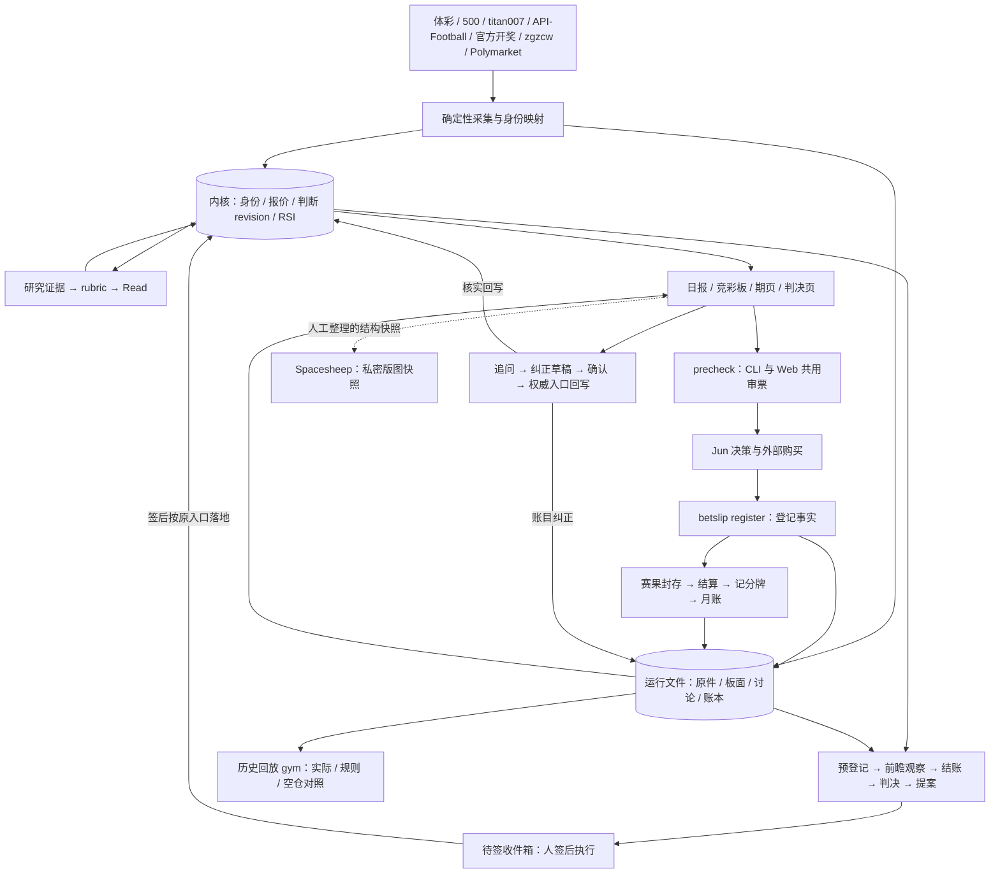

# Nutmeg 当前系统版图

核对日期：2026-11-05。当前代码基线：`ce6bbd27`。这是现役系统的阅读视图，不取代 `docs/ARCHITECTURE.md` 或 SOP，也不是实时健康监控。

- 交互版：`index.html`（自包含，可离线打开）。
- 取证快照：`snapshot.json`（只记录结构、时间和装载状态，不复制账本内容）。
- 外部展示：Spacesheep 私密页面；部署身份与版本见交付后生成的 `deployment.json`。

## 系统总图

研究判断由运行时分析员给出，脚本负责采集、验证、派生、确定性算术和存储。机器承担研究、风控、账房和实验；真实购买由 Jun 完成。

## 事实源与边界

| 对象 | 权威位置 | 读者 / 下游 |
|---|---|---|
| 身份、市场、判断 revision、RSI 状态 | `.nutmeg-data/ontology/ontology.db` | 研究投影、工作台、实验结账 |
| Read 视图 | 由最高内核 revision 投影的 `reads.json` | 判决页、简报、机器初稿 |
| 实票登记 | `.nutmeg-data/betslips.jsonl` | 结算、审票同伴对照、账房；2026-10-08 起不再镜像进内核票据表 |
| 记分牌与资金复盘 | `.nutmeg-data/scoreboard.json` | 月账与实际对照；不从内核历史票表反推当前资金 |
| 讨论与问答 | `daily/<日>/discussion.jsonl` | 会话、行内追问、应答线程 |
| 提案与纠正 | `proposals.jsonl` / `corrections.jsonl` | `/inbox` / `/corrections`；确认与已回写是不同状态 |
| 发送去重 | `notifications/ledger.jsonl` | Telegram 通知；版图发布不调用业务发送 |
| 任务交接 | 当前聊天的 `task_checkpoint` | 会话恢复辅助；继续前仍核对项目原件 |

审票结构否决 V1 / V2 与资金纪律是不同层：V1 为期望回报率低于 0.5；V2 为共享裸单；V3 为倍投警告。止损、期帽、日帽等仍按现行纪律在预审层检查。登记是事实记录，不冒充真实购票。

## 当前核查结果

| 项目 | 核实结果 | 依据 |
|---|---|---|
| launchd 定义 | 19 份 plist | `ops/launchd/` 解析 |
| launchd 装载 | 18 个 | 对 19 个 label 逐一 `launchctl print`；装载不代表每次业务成功 |
| 状态页枚举 | 17 行 | `uv run nutmeg ops-status`，读取已安装副本；漏列但已装载的是 `zucai.lineups` |
| 未装载定义 | `decision.lanip` | 直接装载检查未找到；未启动或安装它 |
| OpenClaw 定时任务 | 3 个启用 | 当前 `ops-status`；08:10 / 12:30 / 17:15 |
| 内核 | 55 张业务及治理表，迁移基线 1 | SQLite 只读查询；`baseline_2026_10_13` |
| 当日产物 | 日报、会话、待决、RSI 报告存在 | 文件存在与修改时间见 `snapshot.json`；存在不等于内容质量已验收 |
| 对外报告代码 | 尚未作为当前入口核实 | 原有未跟踪的 `public_report.py` / report 模板，当前 CLI / Web 无注册；不改动、不视为已投产 |

`docs/ARCHITECTURE.md` 仍写 14 个 launchd 作业；本图用当前直接核查的数量，并明确时点。未把这次阅读任务扩展成调度修复。

## 每日关键时序（北京时间）

08:00 入板；08:10 内核结算；09:30 / 15:30 赛果回填；09:45 / 15:45 日结算；10:00 深研；10:05 赛程采集；10:45 RSI；11:00 / 14:00 / 18:30 足彩备料；12:00 / 14:20 / 18:35 日报；12:30 / 18:45 判决页；12:30 补结算；16:30 午后研究；17:15 临场刷新。

高频：每 10 分钟截止播报、每小时 RSI 巡检、每 15 分钟首发巡检；常驻 `decision-web`。周报和月账按各自 plist 执行。

## 核对来源

`AGENTS.md`、`README.md`、`docs/ARCHITECTURE.md`、当前 `nutmeg --help` / `ops-status`、`nutmeg/interfaces/cli/`、`nutmeg/interfaces/decision_web*.py`、`nutmeg/decision/precheck.py`、`judgment_projection.py`、`rsi_loop.py`、`asks.py`、`proposals.py`、`corrections.py`、`day_runs.py`、`ops_status.py`、`nutmeg/ontology/repository/`、`nutmeg/gym/`、`ops/launchd/`、项目级 `.codex/config.toml`。

未读取或上传密钥文件。交付页只包含系统结构与必要状态摘要，不复制账户明细、票面、截图、用户问答或业务原始数据。
